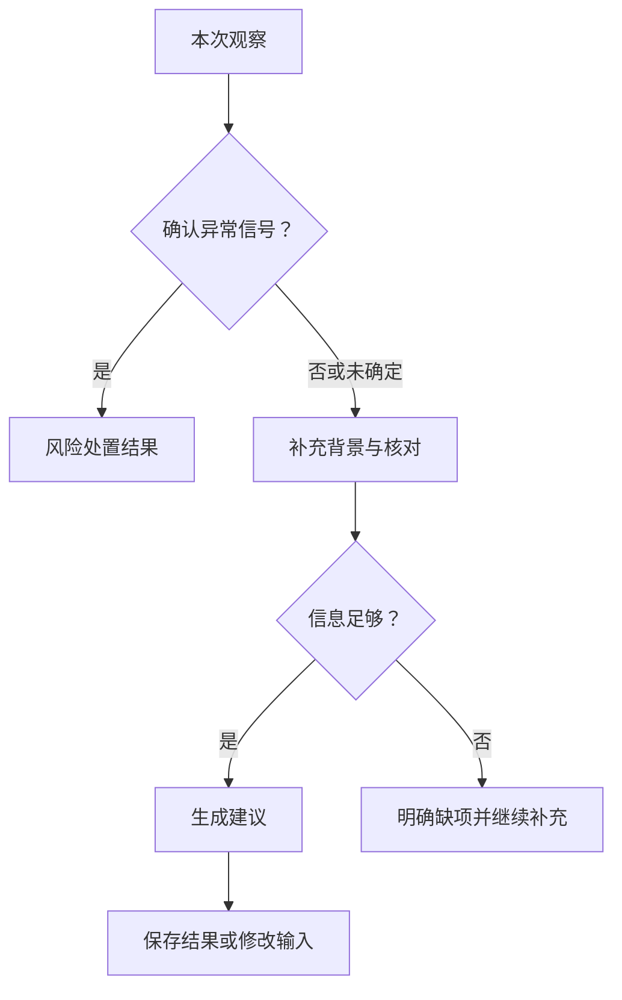
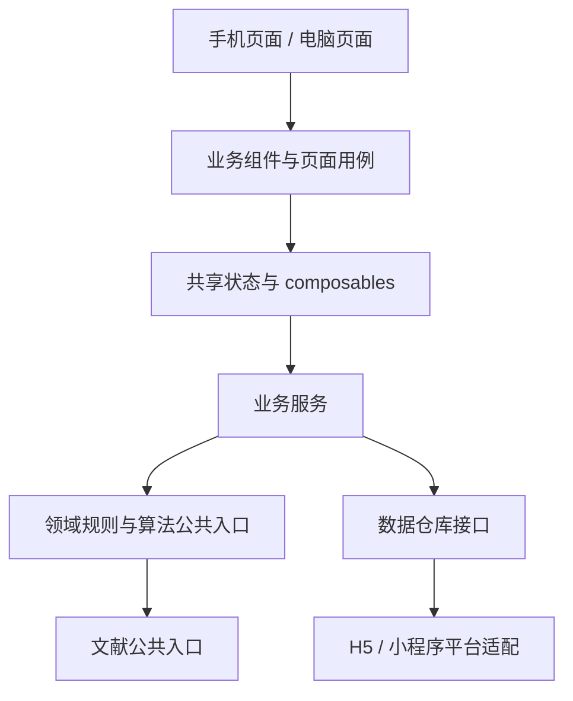
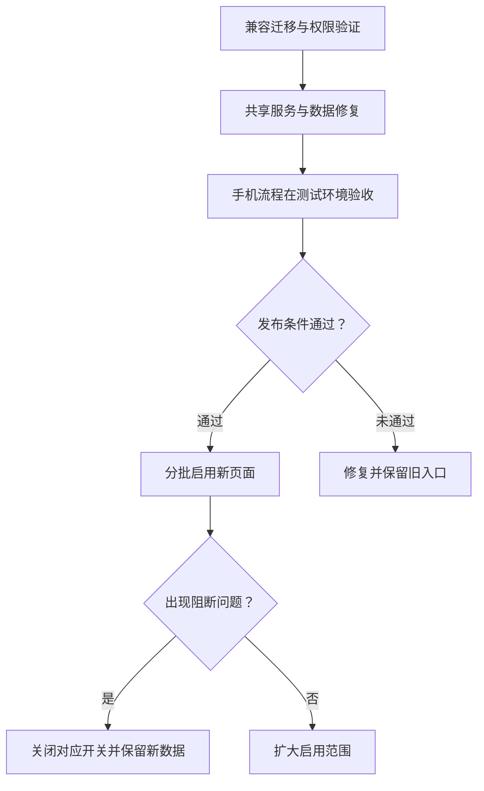

# Ferjoo 手机端交互与 UI 重构指导书

> 从桌面工具的纵向适配，转向围绕日常养护任务的手机产品。
>
> 文档用途：产品决策、交互设计、视觉设计、Vue 前端拆分、后端补齐、小程序开发及验收的共同依据。
>
> 审阅日期：2026-10-15（UTC）。仓库基线：[`hxh2002/Ferjoo`](https://github.com/hxh2002/Ferjoo)，提交 [`ad97252450c954b4a57293a8a2c5cfcbd06c3b06`](https://github.com/hxh2002/Ferjoo/tree/ad97252450c954b4a57293a8a2c5cfcbd06c3b06)。后续仓库发生变化时，应先重新核对差异。

## 阅读导航

- [一、重构结论与执行边界](#一重构结论与执行边界)
- [二、现状审阅与必须先解决的问题](#二现状审阅与必须先解决的问题)
- [三、用户任务与产品概念](#三用户任务与产品概念)
- [四、信息架构与导航](#四信息架构与导航)
- [五、核心流程与字段规则](#五核心流程与字段规则)
- [六、逐页交互规格](#六逐页交互规格)
- [七、历史数据与图表专项](#七历史数据与图表专项)
- [八、视觉规范落地](#八视觉规范落地)
- [九、通用交互与异常状态](#九通用交互与异常状态)
- [十、数据模型与接口补齐](#十数据模型与接口补齐)
- [十一、Vue 架构与组件职责](#十一vue-架构与组件职责)
- [十二、小程序开发约定](#十二小程序开发约定)
- [十三、权限与数据共享](#十三权限与数据共享)
- [十四、现有文件迁移对照](#十四现有文件迁移对照)
- [十五、分阶段实施与回退](#十五分阶段实施与回退)
- [十六、测试与验收](#十六测试与验收)
- [十七、可选方案决策表](#十七可选方案决策表)
- [十八、团队交付清单](#十八团队交付清单)
- [附录 A：证据、来源与核查范围](#附录-a证据来源与核查范围)
- [附录 B：上线前检查清单](#附录-b上线前检查清单)

## 一、重构结论与执行边界

### 1.1 建议采用的主方案

手机端采用 **“今天 / 记录 / 我的”** 的底部导航。用户进入后，先看到当前酵种的状态、数据更新时间和一个明确的下一步；记录观察时按任务分步填写；查看历史时先看到最近的观察与变化，再进入曲线或采样详情。设备维护和账号设置从日常养护流程中移出。

保留现有 Vue 3、Vite、Vue Router、Supabase 以及独立算法和文献目录。重构重点是任务组织、数据语义、页面容器、状态管理及跨端边界。**增加更多 Vue 组件本身不能解决交互问题；先固定任务与数据契约，再拆组件。**

| 当前使用方式 | 目标使用方式 |
| --- | --- |
| 先识别 DIAGNOSE、HISTORY 等功能名称 | 先回答“我现在该做什么” |
| 在长表单里理解阶段、比例、温区和选项 | 先报告看到的现象，再补充与本轮有关的信息 |
| 先读月历，再横向查看周时间带，再操作窗口 | 从最近记录进入某天或某段；时间范围通过表单调整 |
| 四张曲线、测试写入、表格同时展示 | 一个主指标、一条解释、一个详情入口 |
| 登录后回到通用页面 | 回到发起登录的任务并恢复上下文 |
| 设备列表承担养护入口 | 酵种承担养护入口，设备作为可选数据来源 |
| 橙色背景、大圆角、装饰性英文层级 | 附件规定的暖白、品牌橙、直角、细边框、笔记分区 |

### 1.2 三类内容必须明确区分

本文使用以下标记，避免把未来方案当成已有能力：

- **【现有】**：已在本次提交的源码中找到实现；不代表生产环境配置和权限已现场验证。
- **【重构】**：通过现有业务能力改写前端即可实现，可能同时需要修复服务层缺陷。
- **【新增】**：需要新表、接口、权限或平台能力，不能只靠页面文案实现。
- **【选项】**：有明确取舍的替代方案；未选择时以正文主方案为默认。

最终目标版包含酵种档案、喂养记录、观察记录和诊断报告持久化，这些属于【新增】。如果当前只批准纯前端工作，可先完成同一套交互的受限版本，但必须保留能力边界：不能显示“已保存到记录”“下次会提醒”等尚未实现的承诺。详见第十五章的版本切分。

### 1.3 本次工作的边界

本指导书提供完整的重构约定，不修改生产数据库、不发布新网页，也不把产品方案视为已通过用户研究的结论。

审阅覆盖全部应用页面和组件、路由、认证与设备服务、诊断主链、视觉样式关键区段、开发与硬件文档、数据库迁移演进和测试入口。对自动生成的组合目录核查结构和枚举执行结果；历史研究文档按其历史身份阅读，不直接当作当前运行接口。

本次没有真实账号、生产数据或设备联调。完成了本地构建和默认测试；浏览器环境缺少可运行的 Chromium，因此没有完成手机页面的浏览器视觉验收。下文的交互问题主要来自源码与可复现的函数行为，不以未经测量的转化率、点击率或访谈结果作依据。

“小程序”暂以微信小程序作为首个目标平台假设。选择其他平台时，保留业务流程和视觉契约，重新核对登录、路由、分享、字体、图表与网络接入能力。

## 二、现状审阅与必须先解决的问题

### 2.1 当前产品与技术事实

| 模块 | 当前实现 | 对重构的影响 |
| --- | --- | --- |
| 应用 | Vue 3 + Vite + Vue Router；没有 Pinia | 可渐进重构，无需先整体换框架 |
| 诊断 `/` | 阶段、比例、高度、温度、经过时间、颜色、气味、pH、备注；快速文本解析；本地生成结果 | 保留算法输入能力，重新组织填写和结果层级 |
| 历史 `/history` | 设备列表、绑定码、成员、月历、七日时间带、自定义窗口、曲线、测试写入、明细表 | 应拆成按任务访问的列表和详情 |
| 资料 `/profile` | 资料、头像裁剪、邀请码、修改密码 | 拆成“我的”入口及独立设置页 |
| 登录与注册 | 邮箱密码、邀请注册；确认邮箱取决于服务配置 | 保留现有政策，修正任务续接；不能假定已接入微信登录 |
| 绑定 `/claim` | 登录后凭 URL 中的绑定码自动调用认领 | 保留旧二维码兼容，增加明确确认和目标设备落点 |
| 数据层 | 浏览器直连 Supabase Auth、REST/RPC、Storage；数据库 RLS | 前端展示权限不能替代服务端授权 |
| 设备 | 设备与用户多对多；设备角色有 owner / member；另有全局管理员角色 | “我的酵种”和“我的设备”不能直接合并为一个对象 |
| 采样 | 原始数据存储；查询层按十分钟桶选取采样时间最新的记录 | 图表必须标明展示分辨率，不假装连续实时数据 |
| 诊断历史 | 没有已实现的诊断报告云端保存表或调用 | “记录”页若包含报告，必须补后端 |
| 喂养与酵种档案 | 没有独立 starter、feed event 模型 | 不能从设备模式自动推断真实喂养行为 |
| 设备控制 | 没有网页控制设备启停、唤醒或修改发酵模式的服务接口 | 按钮应写“记录喂养”，不能写成会控制硬件的“开始发酵” |

### 2.2 交互结构问题

| 问题 | 源码依据 | 手机端代价 | 重构决定 |
| --- | --- | --- | --- |
| 页面入口依赖顶部英文导航 | `AppHeader.vue` | 需要先理解功能名称并频繁够到顶部 | 底部中文任务导航；帮助、品牌介绍进入“我的” |
| 未登录也可先填长表单，提交时才登录 | `DoctorView.vue` 的 `runDiagnosis` | 投入操作后被打断，且表单没有任务恢复机制 | 在开始记录时告知登录要求；中途过期恢复草稿 |
| 默认已选成熟、比例和涨幅 | `DoctorView.vue` 的 `form` | 用户可能把默认值误认为系统识别 | 初次不预选事实；历史偏好只作待确认预填 |
| 多组专业选项同时展开 | `ChoiceGroup.vue`、诊断模板 | 判断负担和长距离滚动增加 | 观察优先、背景按需、提交前核对 |
| 生成结果后滚动到下方 | `scrollIntoView` | 输入和结果的边界不清，重新修改时易迷失 | 独立结果页；保留“修改本次输入” |
| 历史功能高度集中 | `HistoryView.vue` | 读取和管理任务互相干扰 | 最近记录、数据段详情、设备设置分别承载 |
| 周时间带最小宽度与拖拽手柄 | `main.css`、`WeekLanes.vue` | 横向滚动叠加纵向精细拖动 | 手机主流程用列表和起止时间表单；拖拽仅作可选增强 |
| 休眠、故障等混用红色 | `dayStats`、周时间带 | 容易把正常休眠当成异常 | 模式、数据质量、连接状态分别表达 |
| 普通页面暴露手工传感器数据写入 | `measurement-form` | 用户可能误将测试入口当成养护记录 | 从日常页面移出；保留在受控调试流程 |
| 英文按钮、技术追踪、文献均占较大层级 | 结果及历史组件 | 用户先读实现信息才能找到行动 | 首层给结论与下一步；依据分级展开；规则 JSON 进入调试工具 |

### 2.3 上线前必须修复的行为问题

以下不是单纯的视觉偏好。应在 UI 重构前或同一迭代中修复，并增加有针对性的回归用例。

| 编号 | 已核查的问题 | 影响及修复要求 |
| --- | --- | --- |
| F01 | 未提供经过时间时，诊断页仍传入默认的 `1` 小时；温度未提供时，算法默认温区最终代表值为 `26.5°C` | 不能把假设呈现为用户实测。经过时间传空值；温度缺失则不展示剩余估时，或明确标注经过用户确认的假设 |
| F02 | `HistoryView` 的 `toNum(null)` 和 `toNum('')` 得到零 | 缺测被画成骤降。空值必须保留为空；真正的零必须保留为有效值 |
| F03 | `SeriesChart` 按点的序号平均分配横坐标，而非真实时间 | 不等间隔采样被画成等间隔；缺口会被视觉压缩。改为真实时间轴，跨缺口断线 |
| F04 | `pickLatestPerBucket` 的 `asc` / `desc` 比较方向与名称相反 | 服务返回顺序违反契约。历史页的 `mergeRows` 会再次升序，缓解了部分展示影响，但其他调用仍可能出错；统一服务层排序并测分页边界 |
| F05 | 自动发酵段扫描遇到休眠或故障记录时没有立即结束当前段 | 间隔足够短时，休眠两侧的发酵采样会被拼接。应按模式、质量及时间缺口明确切段 |
| F06 | 普通范围加载有 token，但轮询和部分补拉没有完整的设备 / 请求版本校验 | 切设备后旧请求可能写入新上下文；所有请求要捕获上下文，过期响应丢弃 |
| F07 | 在线状态依赖设备列表中的 `last_seen_at` 与 `Date.now()`；轮询主要更新读数，未同步刷新设备列表；计算属性也不会仅因时间流逝自行重算 | 状态可能停留在旧值。使用响应式时钟，分别更新最近接收时间与最近采样时间 |
| F08 | 后台月数据补拉失败被静默忽略；最大分页到达后没有明确“未完整”返回 | “未加载”可能被画成“无数据”。接口返回覆盖范围与完整性，UI 显示局部加载状态 |
| F09 | 登录入口、注册链接和注册成功流程没有贯通统一的任务续接 | 登录成功可能进入 `/history`；经注册或确认邮箱后丢失原绑定 / 诊断任务。引入可恢复的任务意图 |
| F10 | 已判定 `discard` 的结果仍携带并展示估时、指标和 pH | 丢弃结论与等待提示并列，容易冲突。结果呈现层执行安全优先；风险页隐藏估时和烘焙相关行动 |
| F11 | 自然语言解析的否定词判断是较粗的全局规则；“没有绿色霉菌，但是有明显恶臭”可解析为空对象 | 快速填写只能生成待确认草稿，不能自动替代安全问题；原文保留，识别字段逐项确认；解析规则另开修复任务 |
| F12 | 文档要求组件不直接调用算法，但 `DoctorView`、`DiagnosisResult` 仍有直接导入 | 先通过服务导出选项、解析、格式化及诊断能力；让组件依赖声明与实际一致 |
| F13 | `architecture.test.js` 读取 `scenarioCatalog.scenarios`，实际生成目录是数组；默认测试脚本又未执行该架构测试 | 默认测试通过不等于架构检查通过。先更新检查与目录契约，再纳入 CI；不要把陈旧测试直接当上线门禁 |
| F14 | 手动窗口只在浏览器按设备保存，键中没有用户身份；退出时也没有明确的上下文清理 | 切账号可能继承上一账号的本机窗口。缓存按账号隔离；注销 / 权限变化清理；本机数据明确标注不跨端 |

### 2.4 应当保留的能力

保留诊断算法公共入口、食品安全覆盖顺序、经验先验与公开证据的区分、设备认领幂等、数据库 RLS、既有二维码路径及原始采样历史。不要为了简化页面而删掉原始选项、重写设备绑定语义或在前端复制另一套诊断规则。

## 三、用户任务与产品概念

### 3.1 以任务建立需求，而非按旧页面拆栏目

以下为基于功能结构提出的需求假设，需用真实任务测试验证。

| 场景 | 用户要完成的事 | 首层应该出现什么 | 不该先要求理解什么 |
| --- | --- | --- | --- |
| 日常回访 | 看当前状态，决定是否再观察 | 当前对象、更新时间、最近观察、一个行动入口 | 月历、数据库字段、设备成员 |
| 初次养护 | 把看到的现象告诉系统 | 朴素问题、示例图、允许“不确定” | 成熟菌群术语、完整规则组合 |
| 已有设备 | 判断读数是否新、哪里有变化 | 采样时刻、数据质量、单指标趋势 | 设备在线等于酵种健康的错误联想 |
| 没有设备 | 手工记录并得到建议 | 同等完整的观察入口 | 先购买、先绑定设备 |
| 准备下一次喂养 | 记录已经发生的喂养 | 时间、比例、可选基线 | 把记录误认为远程硬件控制 |
| 回看问题 | 找到某次观察或某段变化 | 最近记录、日期筛选、详情 | 先在周视图精确画窗口 |
| 家庭共享 | 让另一账号查看设备数据 | 明确的访问范围、成员角色、加入结果 | 用户 ID 与绑定码的区别由用户自行猜测 |

### 3.2 固定四个业务概念

| 概念 | 用户语言 | 数据含义 | 不能混同的对象 |
| --- | --- | --- | --- |
| 酵种 | “小橙”“全麦种” | 用户养护的对象，可无设备 | 设备 |
| 本轮喂养 | “今天早上喂过的一轮” | 用户确认的喂养事件与后续观察上下文 | 自动连续采样段 |
| 观察 | “现在看到它涨了多少，有没有异常” | 某时刻的手工确认与可选设备快照 | 每一条传感器采样 |
| 数据段 | “这段时间有发酵模式的数据” | 按采样模式、质量与间隔识别出的范围 | 已验证的完整发酵周期 |

“设备正在发酵”只说明设备上传的模式值；“已经喂养”由用户记录；“达到峰值”需要轨迹或用户明确观察。不能在文案里把三者互相替代。

### 3.3 统一信息优先级

每个日常页面按照“对象与时效 → 当前事实 → 下一步 → 解释 → 原始细节”组织。

异常外观或气味的确认优先于活性判断；缺测与故障优先于趋势解释；经验估时始终以范围和假设出现。不要使用“健康分数”“安全百分比”“精准倒计时”等现有数据与算法不能支持的表达。

## 四、信息架构与导航

### 4.1 主方案：三个稳定入口

| 底部入口 | 核心职责 | 主要内容 | 子页面 |
| --- | --- | --- | --- |
| 今天 | 继续当前养护任务 | 酵种切换、状态、最近观察、当前轮、数据时效 | 记录观察、记录喂养、结果、趋势详情 |
| 记录 | 找回过去的事实与建议 | 观察 / 喂养 / 报告时间线；日期与对象筛选 | 记录详情、数据段详情、采样详情 |
| 我的 | 管理低频设置 | 个人资料、设备、邀请码、账号、安全、帮助、关于 | 设备设置、成员、绑定、头像、密码 |

底部导航始终使用图标加中文名称。当前入口除颜色外还有字重或边框标识。不要在中间放一个像导航项的“＋”动作按钮；动作应有动词，出现在当前任务上下文里。

### 4.2 页面层级和返回规则

| 页面类型 | 顶栏 | 底部导航 | 返回行为 |
| --- | --- | --- | --- |
| 一级页 | 页面标题；必要时对象切换 | 显示 | 切 Tab 保留各自筛选和滚动位置 |
| 二级详情 | 返回、对象或标题、必要时更多 | 通常隐藏 | 返回原列表、原筛选、原滚动位置 |
| 填写任务 | 返回、任务名、步骤提示 | 隐藏 | 回上一步；首步返回先保存草稿，必要时提示 |
| 短选择面板 | 标题、关闭、选项 | 面板覆盖导航 | 系统返回先关面板；取消不提交选择 |
| 登录 / 注册 | 返回、明确标题 | 隐藏 | 完成后恢复原任务，不统一跳首页 |

同一时刻只出现一个底部主行动区。填写页既有“下一步”时，不再叠加底部导航、悬浮加号与悬浮帮助按钮。

### 4.3 建议路由契约

以下是逻辑路由，不要求 URL 文本与小程序物理路径逐字相同。

| 路由标识 | H5 建议路径 | 参数与含义 |
| --- | --- | --- |
| today | `/today` | 当前酵种来自账号内上下文 |
| records | `/records` | 筛选只存非敏感对象 ID、日期或类型 |
| me | `/me` | 账号入口 |
| checkin | `/checkin/:draftId` | 草稿 ID；步骤由草稿状态恢复 |
| report | `/reports/:reportId` | 云端报告 ID；未保存结果使用独立本机会话路由 |
| feeding | `/feeding/:draftId` | 记录已发生的喂养 |
| recordDetail | `/records/:recordId` | 记录的只读快照 |
| segment | `/devices/:deviceId/segments/:segmentId` | 自动数据段；手动范围使用经过校验的时间参数 |
| devices | `/me/devices` | 设备列表 |
| deviceSettings | `/me/devices/:deviceId` | 改名、成员、分享范围、技术信息 |
| deviceClaim | `/claim` | 保留旧二维码；短期仍接收 `code` 并清理 URL |
| account | `/me/account` | 登录方式、密码、退出 |
| help | `/help/:topic` | 与当前问题相关的说明 |

兼容旧链接：旧 `/history` 进入记录页的“设备数据”视图；旧 `/profile` 进入“我的”；旧 `/` 进入今天页，但为旧诊断入口保留明确的“记录观察”路径。迁移时不要让旧二维码变成找不到页面。

### 4.4 对象切换约定

- 顶部显示当前酵种名称及可选关联设备名称；多对象时提供显式切换按钮。
- 单对象用户不必先进入选择器；显示对象名称并提供管理入口即可。
- 切换器先列最近使用的酵种，再提供“添加酵种”；绑定设备是另一个明确动作。
- 【新增】酵种与设备的关联要有生效时间。设备移到另一瓶后，旧数据不能自动改归新酵种。
- 未提供酵种档案的过渡版，切换器必须标“设备”，手工入口标“手工观察”；不能把设备昵称伪装成已建立的酵种档案。

## 五、核心流程与字段规则

### 5.1 初次进入与登录政策

主方案保留当前“诊断需登录、注册需邀请码”的业务政策，但把门槛提前到“开始记录观察”。未登录首页可展示产品用途、示例状态和帮助，示例必须标明“示例”。用户点击主行动时进入登录；已登录后直接进入实际任务。

如果产品选择游客诊断，应单独批准其能力边界：允许在本地生成建议、哪些草稿可保存、何时要求账号、如何迁移到账号。不要仅删除前端判断就宣称已完成游客模式。

认证意图需保存 `intentId`、目标任务、草稿 ID、来源上下文、创建时间。注册、登录、邮箱确认都引用同一个意图。URL 仅携带不可直接表达诊断信息的引用；不把密码、完整观察、报告或绑定码反复拼接到跳转链接中。旧绑定码落地后尽快转入受控临时状态并替换地址。

### 5.2 记录观察：建议的分步结构

默认采用三个填写步骤，结果为独立页面；每步允许返回修改。不要选择一个选项后立即自动跳下一步，避免误触和读屏用户失去上下文。

| 步骤 | 用户问题 | 内容 | 完成条件 |
| --- | --- | --- | --- |
| 观察 | “现在看起来怎么样？” | 本次颜色 / 霉斑、气味、主要涨幅表现；看不懂的选项可看帮助 | 安全问题主动确认；涨幅已选择或明确“不确定” |
| 本轮 | “这是哪一轮的状态？” | 阶段、喂养比例、喂养时间或已过时长、可选温度；pH 和备注按需展开 | 缺少事实用“不确定 / 未测量”；无伪造默认值 |
| 核对 | “这些信息对吗？” | 原始输入、预填来源、自动读数时间、估时缺项提示 | 可逐项编辑；提交后生成结果 |

如果用户已确认本轮背景，可以把本轮步骤压缩为摘要，但安全问题必须本次重新确认。界面显示“沿用本轮比例，点此修改”，而不是让用户猜它来自哪里。

未确定不是“已确认正常”。如用户无法判断颜色或气味，页面应给出可观察的说明和进一步检查入口，暂停正常养护结论；任何位置一旦明确确认异常，直接进入风险分支，无需填完比例、温度等无关字段。

### 5.3 现有算法选项必须完整保留

不得为了手机端简洁而把不同语义无声合并。

| 字段 | 现有值 | 手机端组织方式 |
| --- | --- | --- |
| 阶段 | `mature`、`start_d1`、`start_active`、`start_stable`、`revive`、`fridge` | 先按“稳定养护 / 从零起种 / 从冷藏恢复 / 冷藏维护”分组；从零起种再展开对应阶段说明；保留“不确定”分支 |
| 比例 | `1:1:1`、`1:2:2`、`1:3:3`、`1:5:5`、`deep_reset`、`1:2:1` | 常用项首层，其余通过“其他已支持比例”展开；始终标“老种 : 水 : 面粉”，按重量说明 |
| 高度 / 表现 | `none`、`slight`、`near`、`double`、`peak_plus`、`over3`、`fallen`、`hooch` | 使用可点选的描述和示意；“已回落”“表面液层”放在同一问题的其他表现组，仍属于唯一选值 |
| 温度 | 当前表单滑块，算法以数值归一化 | 数值输入为主，可选步进按钮；设备值先展示来源并由用户确认 |
| 时间 | 当前支持已过小时数 | 优先问“什么时候喂的”，同时保留“只知道大约过了多久”和“不记得” |
| 颜色 / 气味 | `normal` / `suspicious` | 每题增加前端 `unknown`，提交前处理；不直接把 `unknown` 当正常送入算法 |
| pH / 备注 | 可选 | 不是完成任务的前提；保持折叠；异常备注不得被折叠状态掩盖 |

`hooch` 在当前模型里与涨幅混在同一轴，这是已存在的建模限制。首版保留原有单选语义并提示“请选择最主要的表现”。如果要同时记录“翻倍且有液层”，需要【新增】拆成 `growthState` 与 `surfaceObservation`，并更新服务和算法契约，不能由前端随意舍弃其中一个事实。

不支持的自定义比例不能偷偷映射到最接近的已支持比例。可以保存原始比例，并说明“当前模型暂不支持此比例估时”；在域层未补齐前，不生成依赖该比例的完整判断。

### 5.4 输入的事实、来源和有效性

| 规则 | 具体约定 |
| --- | --- |
| 初次填写 | 阶段、比例、高度不选事实默认值；提供“不确定”；颜色、气味不得默认正常 |
| 沿用背景 | 显示上次确认时间和来源；本轮切换时使不再适用的背景失效 |
| 自动读取 | 展示设备、采样时间、质量；不自动把环境温度当作实际酵种温度 |
| 空与零 | `null` / 空字符串是未提供；零是一个需要按字段语义校验的数值 |
| 时长 | 已过时长不可为负；喂养时刻不得在未来；跨日必须有日期 |
| 长时长 | 超出当前手机输入器范围时允许改用日期时间；提示可能不适合估时，不静默截断成上限 |
| 数值键盘 | 温度、pH 等使用数值输入与清晰单位；滑块只能作为辅助输入 |
| 字段错误 | 在字段下显示具体原因，保留已填写内容，定位到第一个需要修改的字段 |
| 异常备注 | 在解析后核对页面突出显示；不依赖单次自然语言解析做最终安全判定 |
| 输入版本 | 每次生成结果记录输入 schema、算法版本和事实来源；后续修改生成新结果，不改写旧报告 |

温度和 pH 的“仪器可能范围”“算法估时适用范围”“当前业务表单允许范围”是不同概念。现有 pH 输入范围与算法异常判断也不完全相同。重构时由域层统一校验与解释；UI 不得仅凭输入框范围就声称数据可靠。

### 5.5 结果呈现的优先顺序

| 条件 | 首层结果 | 估时与行动 |
| --- | --- | --- |
| 确认异常外观或气味 | 风险处置页 | 隐藏等待、烘焙和常规喂养行动，保留项目已有风险处置建议 |
| 安全问题未确定 | 需要进一步检查 | 不给“状态正常”或正常养护倒计时 |
| 输入无效 | 修正输入 | 不调用依赖无效字段的诊断 |
| 阶段 / 比例 / 涨幅缺少关键事实 | 补充信息 | 不让算法默认值替代用户事实 |
| 非成熟阶段 | 阶段建议 | 主方案不展示成熟种倒计时；后续需独立验证阶段估时模型 |
| 温度缺失或超出可靠高温范围 | 说明限制与下一步观察 | 不展示精确剩余时间 |
| 背景足够但经过时间未知 | 可展示从喂养起算的总时长范围 | 明确“总时长”，不能标为“还需多久” |
| 背景足够且经过时间已知 | 估计的剩余时间范围 | 显示假设和生成时刻；不逐秒倒计时 |
| 已翻倍 / 越峰 | 显示观测到的阶段 | 不再用剩余时间诱导继续等待 |

以上是建议增加的产品呈现保护规则，当前源码未全部具备。依赖科学含义的变化，应由算法负责人审校并通过服务输出稳定的展示状态；视图只渲染，不再独立推理。

### 5.6 记录喂养

【新增】入口名称为“记录喂养”。先问“这次什么时候喂的”，默认展示当前时间但允许修改；再填比例，重量与容器起始高度可选。确认后生成喂养事件；若关联设备，保存关联的有效时间范围。

喂养记录与旧轮的关系：创建新喂养事件时明确结束上一轮的养护上下文，不删除设备原始历史；未完成草稿保留在原轮，不自动挪到新轮。误记可编辑或撤销逻辑记录，并保留修改轨迹。不要在点击后远程切换设备模式，除非将来新增了真实控制接口。

### 5.7 快速文本填写

保留为熟练用户的次级入口，名称“一句话填写”。使用足够大的独立输入页，不采用手机上居中窄弹窗。

处理顺序固定为：原文输入 → 生成识别字段 → 标记未识别与冲突字段 → 用户核对 → 进入同一份结构化表单。不要把它做成独立的第二套诊断系统。解析失败时保留原文，允许改用逐项填写；显示“未识别到温度”等具体反馈，不能仅关闭弹窗。

### 5.8 绑定设备

主方案：扫描或输入绑定码 → 校验格式 → 说明将获取的历史数据访问范围 → 用户确认绑定 → 调用现有 `claim_device` → 进入新绑定设备的详情或选择关联酵种。

【重构】旧 `/claim?code=…` 保留；未登录先保存绑定意图；登录、注册和邮箱确认后恢复。重复绑定显示“已在你的设备中”并提供进入设备，不作为错误。无效码保留输入，网络失败允许重试。

确认步骤的目的是让扫码行为和加入共享关系的效果一致。若保留当前扫码后自动绑定作为【选项】，必须在包装、扫码落地页和任务测试中确认用户能理解这一效果；不得把二维码来源不明时的误绑定归因于用户。

### 5.9 断网、切后台与会话过期

先保存本机草稿，再发起生成 / 保存操作。写入必须等待服务端确认才显示“已保存”。断网时显示“草稿在本机，尚未同步”，手动重试使用同一幂等请求 ID。会话过期后重新登录，回到同一草稿与对象；不得重复生成喂养事件或报告。

退出登录后不自动向新账号恢复上一个账号的草稿。若支持匿名草稿迁移，必须由用户明确选择导入，而不是仅因同一台手机就绑定到新账号。

## 六、逐页交互规格

本章可直接作为线框图和页面验收的起点。页面中“首屏”指信息优先级，不要求所有内容在任意字体设置下强行塞进一个固定高度。

### P01 · 今天

**目的：用户进入后知道正在看谁、信息是否新、下一步能做什么。**

从上到下：轻量品牌与当前对象 → 状态卡 → 主行动 → 本轮摘要 → 最近观察 → 可选设备摘要。营销式大标题和大幅背景不再占据每次回访的首屏。

| 区域 | 内容与行为 |
| --- | --- |
| 当前对象 | 酵种名；设备仅作来源小字；多对象时可切换 |
| 状态卡 | 有有效报告时展示“上次观察的判断”及观察时刻；只有读数时展示“最近采样”，不自动写“酵种状态良好” |
| 主行动 | 有草稿：“继续这次观察”；无草稿且已有本轮：“记录观察”；尚无本轮：“记录喂养”，同时保留“直接观察”次级入口 |
| 本轮摘要 | 喂养时间、比例、经过时长；缺项明确写“未记录”；可编辑逻辑记录 |
| 最近变化 | 选择一个主指标或最近观察摘要；有完整数据才描述变化，不能从局部加载直接总结全天 |
| 设备摘要 | 最近上报、最近采样、故障提示、电量；“设备设置”为低频入口 |

状态分支：

- 无账号：说明用途与登录入口；示例带标识。
- 已登录但没有酵种：提供“添加酵种”；同时说明可手工记录，无需设备。
- 有酵种无设备：手工记录照常使用；“关联设备”作为次级入口。
- 有设备但未采样：显示“已绑定，等待首次数据”；不画零值曲线。
- 最近数据较旧：保留采样时刻和旧值，显示“历史读数”；允许用户手工观察。
- 设备故障：质量提醒置于读数前；受影响指标不参与趋势与估时。
- 上次报告提示风险：首层显示风险结果入口；重新开始新酵种必须是明确的独立动作。

这里不放全屏月历、成员表、规则 JSON、资料完善提示和测试数据入口。

### P02 · 对象选择与添加酵种

【新增】选择器展示名称、最近观察时间、是否关联设备；排序按最近使用，不按数据库创建时间让用户猜。当前选项有勾选和文字标识。

添加时只要求名称；阶段作为可选背景，允许“不确定”。不要要求性别、生日或设备绑定来完成养护对象创建。绑定设备放在创建后的可选下一步。名称为空、重复名称、超长名称均有处理；重复名称可以允许，但选择器需带可区分的次级信息。

### P03 · 观察填写与核对

顶部显示当前酵种和本轮，防止填到另一瓶。步骤提示使用“观察 / 本轮 / 核对”，数字仅辅助。底部固定主按钮，页面正文留足底部空间。

安全问题采用明确单选，不使用默认开启的“正常”开关。高度选择项配相同基线的罐体示意，选中态包括边框、勾选和文字；示意不能成为唯一可操作区域。

编辑已生成报告的输入时建立新草稿，原报告保持只读。用户选择不同阶段后，清理仅适用于旧阶段的估时展示，保留仍然有效的原始观察，避免悄悄重置全部表单。

核对页把“你确认的”“沿用本轮的”“设备读取的”以来源标签区分，至少展示采样时刻和未提供项。技术字段名不出现在用户页面上。

### P04 · 建议结果

正常结果从上到下：一句结论 → 最重要的下一步 → 输入时刻与对象 → 估时范围（满足条件才显示）→ 简短原因 → 完整输入摘要 → 依据与限制。

| 层级 | 展示规则 |
| --- | --- |
| 首层 | 标题使用具体行为或状态，不用单独的“成功”；行动是用户接下来能做的事 |
| 首层主行动 | 未保存时“保存本次观察”；已保存时“返回今天”；若仅生成但无保存能力，写“返回今天”，不显示假保存 |
| 次级行动 | 修改本次输入、复制建议、查看趋势；按数据能力显示 |
| 第二层 | 原因摘要、假设条件、生成时刻和读数来源 |
| 第三层 | 参考来源；公开研究和项目经验先验明确区分；无外链的先验不伪造“来源”按钮 |
| 调试层 | 规则追踪、内部 JSON 从普通用户页面移走；开发或审核工具按权限访问 |

风险结果使用相同品牌结构，但首层只保留处置内容和“查看判断依据”。不要同时出现“状态不错”的绿色卡片、翻倍时间或把 pH 低当作安全保证。风险结果本身也可保存为观察记录，方便追溯。

复制成功显示“已复制建议”；失败时提供可选中文本，不显示无反馈的英文按钮。复制内容包含观察时刻、输入摘要、结论和限制，不默认附上账号信息或完整设备绑定码。

### P05 · 记录

默认使用按本地日期分组的时间线。顶栏含当前对象和日期筛选；类型筛选为“全部 / 观察 / 喂养 / 设备数据”，数据量很少时不强行显示空分类。

每条卡片只显示时间、类型、最有区分度的事实、状态和详情入口。观察卡显示用户确认的涨幅或报告标题；喂养卡显示比例；设备数据卡显示数据段范围和完整性。

默认从最近数据开始，分页加载；保留显式“加载更多”入口。下拉刷新是增强，仍有可点击刷新。列表不因后台新数据而突然跳到顶部，显示“有更新”供用户选择。

月历作为日期筛选工具，不再是首个必须完成的操作。“当天无数据”必须建立在该天已完整查询且无记录的基础上；未加载、查询失败与仅有休眠数据有不同文案和符号。

### P06 · 观察 / 喂养记录详情

展示生成时的不可变快照、当时使用的来源和模型版本，避免算法升级后旧报告悄悄改变。需要用新规则重新判断时，按钮写“基于这次输入重新生成”，生成一条关联的新报告。

更正观察采用“更正记录”入口；保留原始版本及更正时间。删除逻辑记录应说明是否同时删除关联报告；不会删除设备原始采样。当前采样表没有客户端删除能力，不能提供虚假的“删除原始采样”按钮。

### P07 · 趋势与数据段详情

顶部固定设备或酵种来源、时间范围、数据完整性。默认看高度；温度、湿度、电量通过可点选的指标切换，不同时挤四张缩小图。

图上点选显示固定位置的读数卡，支持“前一个点 / 后一个点”；滑动查看是增强。调整时间范围进入独立表单，提交后才应用；取消保持原范围。详细规范见第七章。

### P08 · 我的设备与设备设置

设备列表每行显示设备名、最近接收时间、数据质量摘要及我的角色；“绑定设备”是列表页的明确入口。列表和设置页都不暴露上传密钥。

设备设置顺序：设备名称与角色 → 数据来源与最后活动 → 关联酵种 → 共享与成员 → 技术信息 → 解绑。常规成员与管理者看到不同能力，服务端仍逐次授权。

改名进入简短编辑页或短面板，提交前显示它会对共享成员生效。普通成员可通过现有 RPC 解绑自己；owner 无法通过现有 RPC 解绑自己，界面不能做出可成功退出的承诺。转移 owner 属于新增流程。

### P09 · 绑定落地与完成

绑定页只承担一个任务。绑定码允许粘贴并显示规范化结果；不要把字母型绑定码强制唤起纯数字键盘。邀请码与设备绑定码分别命名和解释。

绑定成功后显示设备名、我的角色和“查看设备”；【新增】酵种模型已启用时，提供“关联到哪份酵种”作为下一步。不要把所有绑定结果都送回一个没有选中新设备的数据列表。

二维码不是相机权限的唯一入口：H5 可从外部扫码进入 URL，也可手工输入；页面内扫码作为可选平台能力。拒绝权限后仍保留输入路径。

### P10 · 我的

首层保留头像与昵称、设备、邀请码、账号与安全、帮助、关于。用户名未设置不强制补全。生日、性别、身份不作为日常任务入口，也不作为使用诊断的必填条件。

全局管理员显示“管理工具”独立入口，不把管理员的全部设备列表混成普通用户的“我的设备”。需要查看全局设备时，有明确模式标识和退出入口。

### P11 · 登录、注册与邮箱确认

登录页在表单上方写清将继续的任务，例如“登录后继续绑定设备”。输入框有常驻标签；密码支持显示 / 隐藏和系统自动填充。

注册先说明邀请制，再要求现有必要字段；昵称可以后补。是否去掉确认密码是可选设计，若保留则不改变现有校验；若去掉则必须有密码显隐和明确校验反馈。

注册返回有会话时直接续接任务；没有会话时进入“检查邮箱”状态。源码文档对是否启用邮箱确认存在相互矛盾的说明，因此实现必须根据认证返回和实际环境配置决定，不硬编码某一种结果。

忘记密码是现有缺口：【新增】补齐认证服务的重置邮件、回调与设置新密码流程后，再出现“忘记密码”入口；不能只做不可工作的链接。错误信息转换为用户能理解的中文，不向普通用户展示环境变量或 Supabase 配置步骤。

### P12 · 资料、头像与账号安全

资料分为可选资料与账号安全。头像裁剪独立全屏，支持移动、缩放、重置和明确保存；取消、图片加载失败、上传失败都保持可返回。裁剪框随可用宽度布局，不沿用固定画布尺寸导致小屏溢出。

头像上传、资料更新和旧文件清理分别管理状态：资料更新失败时不假装保存成功；新文件成为孤儿时安排清理；旧头像清理失败不阻塞已成功的新头像显示。显示名称、头像等更新后刷新账号展示状态。

邀请码页面保留配额及已使用人数，名额用完时可查看但说明无法新增邀请。退出登录放在账号页底部，避免日常导航误触；有未同步草稿时先说明影响。

## 七、历史数据与图表专项

### 7.1 三种时间结构分开实现

| 结构 | 用途 | 默认入口 | 修改权限 |
| --- | --- | --- | --- |
| 按日时间线 | 找到过去发生的事件 | 记录 Tab | 筛选，不改数据 |
| 自动数据段 | 查看某段连续有效的发酵采样 | 设备数据卡 | 原始边界只读；允许创建派生查看范围 |
| 用户查看范围 | 放大观察某个区间 | 趋势详情的“时间范围” | 修改自己的范围，不改原始采样 |

只有在喂养事件存在、用户确认并绑定上下文后，才使用“本轮”。自动段和手动范围都不直接被重命名为真实喂养周期。

### 7.2 自动切段规则

把现有窗口识别从 `HistoryView.vue` 移入领域层，形成可独立测试的函数。至少固定：

1. 先按设备、采样时间与稳定的并列键排序，再处理重复和展示桶。
2. `fer` 且关键传感器有效的采样才可加入有效发酵数据段。
3. 遇到 `sleep`、明确故障或未知模式时结束当前有效段；未知不归为休眠。
4. 相邻有效采样缺口超过配置阈值时切段。当前阈值为四十分钟，可暂保留以降低迁移变量，但必须标为项目策略并验证硬件实际采样节奏。
5. 单个有效点保留为采样记录，显示“数据不足以形成趋势”；不能因未达到窗口点数就从页面完全消失。
6. 段的标识不要只依赖可能随补传改变的起点。需要稳定 ID，或明确的旧段与新段匹配策略。
7. 后台补传可能改变自动段边界；用户保存的查看范围保留自己的起止时间及来源版本，不因算法重算被覆盖。

当前硬件存在离线补传，因此“最后收到数据”和“最新采样的时间”必须同时保留。收到一批旧采样可以说明设备刚连接过，但不能说明当前读数很新。

### 7.3 图表必须遵守的语义

| 项目 | 实施要求 |
| --- | --- |
| 横轴 | 按实际时间映射；不能按点序号等距排布 |
| 纵轴 | 明确单位和刻度；看单段可自适应范围；跨轮比较必须统一刻度或明确标注不同尺度 |
| 折线 | 默认直线连接；不用可能过冲的平滑曲线制造未经采样的峰值 |
| 缺测 | 空值、故障、过长缺口处断线；不补成零、不跨缺口推断状态 |
| 单点 | 显示点和时间读数，不画虚构趋势 |
| 完全相同数值 | 保持稳定的纵轴留白；不放大数值噪声 |
| 采样分辨率 | 显示“按十分钟展示”；说明每桶取采样时间最新的一条 |
| 图表阅读 | 点选后在图外固定读数卡显示数值、单位、日期、时间、质量；不要求悬停 |
| 可访问替代 | 提供摘要与可浏览的采样列表，读屏用户不用操作图形也能读数据 |
| 选点与滚动 | 默认纵向滚动页面；不在整块图上屏蔽所有触摸；只在必要交互区处理手势 |

例：采样分别发生在第零、十、六十分钟。原图等距排点会让中间点看起来在半小时位置；正确时间轴应让它靠近起点。此项已以数值映射和反算核对。

### 7.4 数据质量与连接状态分开

| 维度 | 建议状态 | 用户文案示例 |
| --- | --- | --- |
| 连接 / 接收 | 最近接收、较久未接收、从未接收 | “最近收到设备数据：…” |
| 数据时效 | 新近采样、历史采样、无采样 | “这条读数采于…” |
| 设备模式 | 发酵、休眠、未知 | “设备模式：休眠” |
| 指标质量 | 有效、缺失、故障、时间异常 | “高度传感器异常，暂不绘制” |
| 范围覆盖 | 完整、部分加载、查询失败、达到查询限制 | “当前仅加载了部分时间范围” |

“在线”不代表“读数有效”，“发酵模式”不代表“活性良好”，“休眠”也不是故障。状态色、图标、文字与算法输入都按这些维度独立处理。

### 7.5 时间范围编辑

用开始日期时间、结束日期时间、时区说明、范围内采样数、预览摘要和“应用范围”。开始必须早于结束；不允许未来结束点；跨日显示日期；范围超过可查询边界时明确提示。

保留当前范围最短十分钟的策略作为兼容默认，并把它从组件常量提升为领域配置；是否允许更短区间是独立产品选择。取消不改变范围。重置按钮写“恢复自动范围”，不笼统写“重置”。

电脑端可以继续提供周时间带与拖动，但必须有等效的可点击 / 表单操作。W3C 的拖拽条款也要求在非必要拖拽场景提供不依赖拖动的操作方式。[外部依据 E03]

### 7.6 日期、分页和缓存

数据库保存 UTC 时间戳；查询某个本地日期时，用该时区的当天零点与下一天零点转换成 UTC，使用左闭右开的范围。不能固定加一天的毫秒数来计算所有本地日期，夏令时切换日可能不是二十四小时。

本次用 `America/Los_Angeles` 验证：2026-03-08 的本地日为二十三小时，2026-11-01 为二十五小时。跨日列表、周范围及选点都要测试这一情况。对于同一秒内的重复记录，使用稳定并列键决定最新展示记录，并保留原始记录可追溯性。

优先加载当前所需范围，不在每次进入时取完整月份。返回覆盖区间、分页游标、是否完整和缺口；达到页面上限必须显式返回受限状态。长时间跨度使用服务端聚合或渐进分页，不把十分钟展示桶当成数据库原始采样的唯一记录。

## 八、视觉规范落地

### 8.1 附件的地位和适用方式

附件是 `Ferjoo · Web visual guidelines V0.1`。其结尾明确说明 **Logo 与字体已确认，其余为视觉提案**。本指导书以这些提案作为本次执行默认，方便形成一致的手机端系统；新增语义色、控件边框和任务页字号属于下述明确列出的扩展。

HTML 中前段仍有早期圆角样式，但末尾的 `FermentSense structure, Ferjoo identity` 覆盖为直角。应以最终生效 CSS、PDF 展示和文字约定一致的“直角结构”为准，不能只拷贝最前面的样式声明。

### 8.2 必须继承的视觉资产

| 项目 | 附件规则 | 手机业务页应用 |
| --- | --- | --- |
| Logo | 保留原有字形与像素细节，不拉伸、旋转、加阴影 | 一级页可展示原始标识；二级页以任务标题为主，不重复大 Logo |
| Logo 留白 | 四周至少为标识高度的四分之一 | 在组件内固定安全区，不能被返回按钮侵入 |
| Logo 最小宽 | 网页显示宽度不小于 `112px` | 不缩成难辨的小字标；空间不足时二级页不展示字标 |
| 浅底 / 深底 | 浅底用渐变，品牌或深色背景用反白 | 不能把白色 Logo 放在对比不足的浅橙底 |
| 结构 | 直角卡片、直角输入、直角按钮，细线描边，编号分区 | 不延续当前胶囊导航、大圆角玻璃卡片 |
| 空间 | 以 `4px` 为基准；手机左右 `20px`；单列卡片 | 页面外边距统一，分组主要靠留白和分隔线 |
| 品牌渐变 | 五个 Logo 橙色节点 | 品牌区域有限使用，正文和实时数据区域保持平静底色 |

编号分区只出现在需要建立秩序的章节或填写步骤，不给每个普通按钮编号。大段留白适合介绍页，任务页应以可阅读的密度组织，避免用户反复滚屏找“下一步”。

### 8.3 基础颜色与语义扩展

| Token | 色值 | 用途 | 来源 |
| --- | --- | --- | --- |
| brand.primary | `#FF6B25` | 主按钮、关键标记 | 附件 |
| brand.gradient.2 | `#FF762E` | 标识渐变 | 附件 |
| brand.gradient.3 | `#FF9646` | 标识渐变 | 附件 |
| brand.gradient.4 | `#FFA954` | 标识渐变 | 附件 |
| brand.light | `#FFB05A` | 标识渐变、品牌展示 | 附件 |
| surface.page | `#FFF9F3` | 页面暖白底 | 附件 |
| text.primary | `#30251F` | 正文、主要图标、按钮文字 | 附件 |
| text.secondary | `#75665B` | 辅助说明 | 附件 |
| border.decorative | `#EADDD2` | 静态卡片与分区线 | 附件 |
| border.control | `#8D796A` | 需要识别边界的输入控件 | 本指导书扩展 |
| text.link | `#A54214` | 暖白底的正文链接 | 本指导书扩展 |
| status.danger.text / bg | `#9A352A` / `#FFF1ED` | 明确风险和重要错误 | 本指导书扩展 |
| status.good.text / bg | `#286247` / `#EDF5ED` | 已确认的成功状态 | 本指导书扩展 |

休眠、未知、历史读数主要使用次级文字和不同图标；不要给每一种普通状态分配一个高饱和颜色。风险和成功必须同时有文字与符号，不能仅靠红绿区分。

### 8.4 已计算的对比度与实际用法

下表按 sRGB 相对亮度公式计算，并以反向颜色组合核对。显示值保留两位，是否达标按未舍入值判断。

| 组合 | 对比度 | 结论 |
| --- | --- | --- |
| `#30251F` 正文 / `#FFF9F3` | `14.25 : 1` | 可作正文 |
| `#75665B` 次级文字 / `#FFF9F3` | `5.28 : 1` | 可作普通辅助文字 |
| `#30251F` 深棕字 / `#FF6B25` | `5.23 : 1` | 主按钮采用这一组合，符合附件 |
| 白字 / `#FF6B25` | `2.84 : 1` | 不作普通按钮文字，也未达到大字的 `3 : 1` |
| `#FF6B25` 橙色字 / `#FFF9F3` | `2.72 : 1` | 不作正文或必须阅读的小字 |
| `#EADDD2` 装饰线 / `#FFF9F3` | `1.27 : 1` | 适合装饰分隔，不能单独承担输入识别 |
| `#8D796A` 控件边框 / `#FFF9F3` | `3.96 : 1` | 可承担输入边界 |
| `#A54214` 深橙链接 / `#FFF9F3` | `5.93 : 1` | 适合正文链接，并配下划线 |
| 风险文字 / 风险底 | `6.53 : 1` | 可作风险正文 |
| 成功文字 / 成功底 | `6.45 : 1` | 可作成功正文 |

文本对比按普通文字 `4.5 : 1`、大字 `3 : 1` 检查；识别控件所需的非文本视觉信息按相关 `3 : 1` 要求检查。不要把浅色装饰边框到处加深，也不要把它用于唯一的选中态或输入边界。[外部依据 E02、E04]

### 8.5 字体与字号

| 角色 | 字体 | 字重规则 | 手机端约定 |
| --- | --- | --- | --- |
| 中文标题 | 附件指定的苹方方案；运行时有系统回退 | 默认 `500` | 页标题 `28px`；卡片标题 `20px` |
| 英文标题 | Fredoka | 默认 `300`；实际轴 `300–700` | 品牌表达用，不承担小号关键操作 |
| 中文正文 | 阿里妈妈方圆体 VF | 正文 `400`，强调 `500–600`；实际轴 `200–700` | 正文 `16px`，行高按附件中文正文建议 `1.75` |
| 英文正文 / 数字 | Rubik | 正文 `400`，强调 `500`；实际轴 `300–900` | 英文正文行高 `1.6`；数据使用可辨识数字 |
| 辅助说明 | 按语言沿用正文字体 | 默认 `400` | `14px`，行高 `1.5`；关键错误不缩小 |
| 介绍页大标题 | 按语言沿用标题字体 | 按附件 | 手机 `36px`；仅用于介绍，不每个任务页都使用 |

附件给出的手机分区标题为 `28px`、卡片标题为 `20px`，正文 `16px`，辅助说明 `14px`。页面标题和分区层级相同是有意收敛，不强行制造更多字号。按钮文字建议 `16px`，数据大字根据长度在视觉稿中验证，不能通过过小单位或截断数值来凑版式。

字体实施要求：

- 不把规范 HTML 中整包内嵌字体原封不动搬到业务页面；按语言、字重和实际字符集拆分，避免首屏被字体阻塞。
- Fredoka 的宽度轴保持附件默认值，方圆体的附加轴保持默认；不为局部控件随意变形。
- Rubik 与方圆体显式指定正文 `400`，不依赖字体文件默认字重。
- 附件注明苹方文件内部名称与来源尚未核验。上线前核对字体来源、分发授权和端侧支持；未确认前使用系统中文标题回退，不分发该嵌入文件。
- 自定义字体失败时也能完成全部任务；小程序支持、远程字体加载和缓存要做真机验证，不把 H5 字体表现当作跨端保证。
- 正文可在【选项】中切换为系统字体以减少加载；这是品牌方案变更，应在决策表明确选定。

### 8.6 空间、尺寸和组件状态

| 项目 | 默认规格 | 解释 |
| --- | --- | --- |
| 外边距 | `20px` | 与附件一致 |
| 组件内间距 | `12 / 16 / 24px` | 依信息量选用，不在同类组件中随意变化 |
| 主按钮 | 最小高度 `48px`、直角、水平内边距 `24px` | 短屏或字放大允许增高和换行 |
| 列表点击行 | 最小高度 `56px` | 双行内容自然增高，整行可点 |
| 常用触控区域 | 默认至少 `48 × 48px` | 项目舒适性目标；图标绘制尺寸可更小 |
| 紧凑关闭 / 图标按钮 | 至少 `44 × 44px` | 只用于密度必要处，不能与邻项重叠 |
| 选择卡 | 最小高度 `64px`，直角 | 标签与说明都能阅读；点击区域覆盖整卡 |
| 输入框 | 最小高度 `48px` | 常驻标签、单位和错误区域分离 |
| 卡片边框 | `1px` | 静态分隔用浅色；交互控件用可识别边界 |
| 底部行动区 | 内容高度自适应 + 设备安全区 | 正文预留同等底部空间 |
| 动效 | 短促的状态过渡；减少动态设置下关闭非必要动效 | 不做循环装饰动画或自动滚动强制引导 |

触控尺寸是本项目建议值，不应说成所有平台同一个强制标准。WCAG 2.2 AA 的目标尺寸条款基准为 `24 × 24 CSS px`，且存在间距等例外；本项目主动采用更大的舒适区域。[外部依据 E01]

按钮状态完整包括默认、按下、键盘焦点、加载、成功、失败、禁用。禁用时在附近说明原因；无法提交不应只靠变淡让用户猜。选中卡片使用较深边框、勾选和文案，不能只换为浅橙底。

底部选择面板沿用直角边界。允许通过标题栏与关闭按钮识别，不需要为了“看起来像手机”统一改成大圆角。系统原生选择器的外观由平台控制，不强行模拟成网页控件。

### 8.7 小屏、横屏和放大文字

手机主要验收宽度建议覆盖 `320 / 360 / 375 / 390 / 430 CSS px`，并补平板与横屏。保持一列核心内容；不要因为横屏就出现鼠标依赖的操作。

日历有一个容易遗漏的边界：页面左右各 `20px`，七列每格至少 `44px` 且不留列间隙时，需要页面宽至少 `348px`。`320px` 宽时每格只有 `40px`。因此在较窄设备上改用日期列表或系统日期选择器，不能直接沿用缩小的七列格子；有列间隙时还要重新计算。

放大文字后，卡片标题、底部按钮和错误提示可换行；图表读数转为上下排列；不通过固定高度裁掉内容。键盘弹出后主按钮保持可达，长表单仍可滚动到当前输入和错误位置。

## 九、通用交互与异常状态

### 9.1 状态模型

不要用一个全局 `busy` 同时表示设备列表、绑定、改名、历史和保存。每个独立资源至少有自己的加载状态、错误和最近成功数据。

| 状态 | 页面表现 | 可用操作 |
| --- | --- | --- |
| 首次加载 | 符合最终结构的轻量占位；可阅读标题 | 返回；取消非必要加载 |
| 后台刷新 | 保留已有数据，显示刷新状态 | 原有读取操作继续可用 |
| 空数据 | 具体解释“没有酵种 / 未采样 / 此范围无记录” | 创建、绑定、改日期或手工记录 |
| 部分成功 | 已有内容正常显示，局部标“尚未完整加载” | 重试失败部分，不清空成功部分 |
| 请求失败 | 用户可理解的原因与局部重试 | 重试、返回；保留草稿 |
| 会话过期 | 保存本机任务后进入登录 | 登录后恢复同一任务 |
| 无权限 | 告知共享关系变化或需要管理者操作 | 返回；刷新设备列表 |
| 数据陈旧 | 显示原采样时刻和“历史读数” | 刷新或手工观察 |
| 正在保存 | 主按钮显示具体动作进行中，避免重复提交 | 按任务规则返回或等待；不重复创建 |
| 未同步草稿 | 明确“仅在本机” | 重试同步、继续编辑、删除草稿 |

“数据加载失败”和“设备传感器故障”是两种错误，必须有不同反馈。错误提示不覆盖用户正在阅读的安全建议，也不只用会很快消失的 Toast 承载关键内容。

### 9.2 页面、面板与弹窗的使用边界

短选择和不需复杂输入的操作可用底部面板；观察、注册、头像裁剪、范围编辑等长任务用完整页面。删除、移除成员和解绑用清晰确认页或对话框；确认文案写对象和后果。

H5 对话框需要标题、焦点进入、焦点限制、关闭后回到触发元素、背景不可交互；支持系统返回和键盘关闭。小程序使用对应平台能力，保持同样的取消与提交语义。不能把 `Teleport` 和 DOM 焦点实现直接搬进共享业务层。

### 9.3 手势、触控和反馈

- 下拉刷新、滑动选点、拖拽裁剪都有可点击替代入口。
- 不用长按作为删除或更多操作的唯一入口；不依赖 hover、title 提示或 Esc 完成手机任务。
- 选择生效要立即有可见状态；网络写入要等确认后再显示成功。
- 双击、连点、超时后重试都只产生一个业务事件；按钮禁用只能减少重复触发，幂等由服务端保证。
- 不让横向图表滑动和浏览器返回手势争用屏幕边缘。
- 刷新数据不覆盖正在编辑的值；可提示有更新，由用户选择重新读取。

### 9.4 文案原则与替换表

| 现有或容易出现的文案 | 建议表达 |
| --- | --- |
| DIAGNOSE / HISTORY | 记录观察 / 记录 |
| 刷新比例 | 喂养比例；帮助里解释项目原术语“刷新” |
| 诊断窗口 | 数据段 / 查看范围；只有用户记录过喂养才称“本轮” |
| 已完成诊断 | 根据这次观察，建议…… |
| 已保存 | 只在云端确认后使用；本机保存写“草稿保存在本机” |
| 未提供时默认 | 未测量；需假设时写明假设并让用户确认 |
| 设备数据不敏感 | 加入后可查看这台设备的全部历史采样 |
| Supabase 尚未配置，请填写环境变量 | 服务暂不可用，请稍后重试；技术细节进入开发日志 |
| INTERNAL | 项目经验先验；说明尚未校准的适用限制 |
| 弱 / 死了 / 安全 | 目前观察到……；还需要……信息；避免超出依据的结论 |

诗意品牌文案保留在介绍、欢迎和空状态中。关键操作、风险提示、错误和数字说明使用直接语言，不能为了品牌语气让用户猜行动。

### 9.5 性能与离线的设计约定

默认先呈现任务骨架、当前对象和可恢复草稿；字体、品牌介绍、完整月数据和文献长列表按需加载。页面代码使用路由懒加载，图表与头像裁剪不进入所有页面的首屏路径。

本机可保存草稿和已读取的只读数据缓存，不默认离线排队执行绑定、成员变更、解绑等权限操作。离线缓存应有账号、对象、版本和时刻；退出或权限撤销清理相关可访问缓存。

性能验收先固定参考真机、浏览器 / 小程序版本、网络和数据量，再确定页面预算。不要把本地构建通过或开发电脑上的流畅表现当作手机性能达标。大历史范围的首屏读取、切换指标、列表返回和字体回退分别测量。

## 十、数据模型与接口补齐

### 10.1 保留现有表，新增业务对象

不要把手工观察写入 `device_measurements` 来省建表。该表现有语义是设备或测试测量；观察的颜色、气味、阶段、备注、诊断结果和喂养事件应独立存储。

| 新对象 | 建议最小字段 | 关键约束 |
| --- | --- | --- |
| starters | ID、拥有者 UUID、名称、可选背景阶段、创建与归档时间 | 首版个人私有；归档不删除历史 |
| starter_device_links | 酵种 ID、设备 ID、生效起止时间、创建者 | 创建时必须有设备访问权；同一传感器在同一时刻默认只关联一份酵种 |
| feed_events | ID、酵种 ID、实际喂养时刻、原始比例、可选质量与高度基线、操作者、修改版本 | 记录发生过的事；请求幂等；不能用默认当前时间替代用户修改后的时刻 |
| observations | ID、酵种 ID、可选本轮 ID、观察时刻、结构化字段、原文、来源、设备引用 | 保存未确定与未测量状态；不能只存归一化后的默认值 |
| diagnosis_reports | ID、观察 ID、输入快照、算法版本、schema 版本、结果快照、证据引用版本、生成时刻 | 报告不可变；重算生成新 ID；保存与展示权限明确 |
| saved_ranges（可选） | ID、用户 UUID、设备 ID、起止时间、来源类型、自动段版本、修改时刻 | 属于用户自己的查看范围，不修改设备原始采样 |
| write_requests 或等效幂等字段 | 用户 UUID、请求 ID、动作类型、结果引用 | 同一请求重试返回同一业务结果；不能仅依靠客户端锁 |

各表的具体命名和关系可按现有迁移习惯调整，但业务含义应固定。新增 SQL 使用新迁移；不要改写已执行的历史迁移来假装部署环境从未存在旧结构。

### 10.2 输入快照必须保留的元数据

| 属性 | 用途 |
| --- | --- |
| rawValue / normalizedValue | 区分用户原始表达和实际用于算法的值 |
| source | `manual`、`device`、`inherited`、`parsed` 等来源 |
| observedAt / confirmedAt | 观察和确认时刻，避免旧事实冒充当前事实 |
| measurementRef | 设备 ID、采样 ID、采样时间与质量 |
| assumption | 哪些值属于假设；主方案不对缺失关键事实偷偷补假设 |
| inputSchemaVersion | 未来字段拆分后仍能读取旧记录 |
| algorithmRevision | 精确到构建或规则版本，而非仅写“最新版” |
| resultSnapshot | 保留当时结论，避免升级规则后历史页面漂移 |
| evidenceSnapshot | 保存稳定引用及版本；当前系统不具备逐句完整证据链时，不声称已经具备 |

现有引用架构有轻量运行时目录、完整证据注册表和历史追踪设计。首版先保存能真实提供的结果与引用快照；逐句 claim / rule / evidence 追踪作为独立演进任务，不为 UI 重构再复制一套文献数据。

### 10.3 服务接口契约

以下为建议契约，除“复用现有”外均需实现后才能在页面开放。

| 服务能力 | 输入 | 输出与错误语义 | 状态 |
| --- | --- | --- | --- |
| 获取当前养护上下文 | 用户、酵种 ID | 本轮、最近观察、关联设备、权限、数据时效 | 新增聚合 |
| 保存喂养事件 | 请求 ID、酵种、时刻、比例等 | 事件 ID、版本；重复请求返回原结果 | 新增 |
| 保存观察与报告 | 请求 ID、草稿版本、输入快照、结果 | 保存后的记录 / 报告 ID；不得部分成功却显示整体已保存 | 新增 |
| 生成诊断 | 经过校验的输入 | 明确的 `discard / clarify / advice` 类状态、展示能力、限制 | 复用现有算法并扩展服务契约 |
| 获取测量范围 | 设备、UTC 起止、游标、展示分辨率 | 点、覆盖范围、完整性、下页游标、质量、稳定排序 | 修复并扩展现有 |
| 获取最新状态 | 设备 | 最近接收时间、最新采样、模式与质量分开 | 扩展现有 |
| 认领设备 | 规范化绑定码、任务请求 ID | 设备 ID、角色、已存在状态 | 复用现有幂等 RPC |
| 成员变更 | 设备、目标系统用户 ID | 明确成功 / 无权限 / 不存在 / 不允许移除 owner | 复用现有 RPC；UI 只承诺其真实能力 |
| 认证续接 | 意图 ID、认证结果 | 可恢复目标；无效 / 过期意图回到安全入口 | 新增前端与回调协作 |

保存观察和报告可在同一数据库事务中完成；如果诊断在本地计算，服务端至少校验结构、归属及版本，记录客户端结果来源。涉及需要服务端可信的能力时，再选择服务端重新计算；不要把用户可修改的客户端结果当成授权依据。

### 10.4 数据迁移与兼容

- 既有设备与原始采样不自动创建“真实喂养周期”。用户可创建档案并选择关联起点，关联前的历史继续以设备来源展示。
- 旧本机手动范围仅迁移结构有效的数据；先校验当前账号仍能访问设备，再提示是否导入。没有原用户标识的旧缓存不自动归给当前账号。
- 所有新增持久数据使用内部 UUID 关联；展示用系统用户 ID 不替代内部身份主键。
- 过渡期写入新业务表、读取旧设备表；必要时使用版本化适配器，不做客户端双写两套相同业务事件。
- 归档酵种、解绑设备、移除成员、删除观察是不同动作；分别解释影响，不用一个“删除”处理全部关系。

## 十一、Vue 架构与组件职责

### 11.1 推荐依赖方向

这是职责边界，不要求每次读取都机械经过每一层。简单展示组件可以直接接收 props；简单局部状态留在组件。不得出现两个分别维护“成熟判断”“安全覆盖”的视图或 store。

### 11.2 推荐目录与职责

| 建议位置 | 职责 | 不应放入的内容 |
| --- | --- | --- |
| `app/` 或现有应用入口 | 启动、布局、路由、依赖装配、能力开关 | 具体诊断规则 |
| `features/today` | 当前上下文的读取、卡片和主行动编排 | 设备 SQL、峰值算法 |
| `features/checkin` | 表单草稿、步骤、核对、结果呈现 | 另一份诊断算法 |
| `features/records` | 记录列表、筛选、详情、返回恢复 | 把原始采样当观察保存 |
| `features/devices` | 设备列表、绑定、共享、设置 | 设备上传密钥 |
| `features/account` | 登录、注册、资料、任务续接 | 在页面里拼接任意外部 redirect |
| `components/ui` | 按钮、输入、选择卡、列表行、状态条、对话框 | Supabase 调用 |
| `composables/` | 有生命周期的可复用状态逻辑 | 纯数值算法 |
| `stores/`（采用 Pinia 时） | 会话、当前对象、跨页面草稿等共享状态 | 每个输入框的瞬时开关 |
| `services/` | 校验、用例执行、权限错误映射、组合数据读取 | 操作 DOM |
| `domain/` | 表单契约、数据质量、时间段、范围、展示能力等纯规则 | 组件实例、浏览器 API |
| `algorithms/` | 保留现有诊断与数值算法的唯一归属 | 页面样式 |
| `references/` | 保留现有引用公共边界 | 到处复制的参考文献列表 |
| `repositories/` | 数据访问契约、分页与持久化 | 页面跳转 |
| `platform/` | 认证存储、请求、导航、剪贴板、图片、可见性、图表宿主适配 | 用户任务决策 |
| `tokens/` | 颜色、字体、间距、尺寸、状态语义 | 随页面复制的硬编码视觉值 |

可以先在现有目录下落实相同边界，再逐步按 feature 迁移，避免为了“架构整齐”一次移动所有文件并同时修改业务行为。

### 11.3 状态放在哪里

| 状态 | 归属建议 | 原因 |
| --- | --- | --- |
| 某个说明是否展开、当前输入焦点 | 组件本地 `ref` | 无跨页恢复要求 |
| 表单步骤和可恢复草稿 | 草稿用例 + 持久化适配；共享 store 持有当前草稿引用 | 登录、返回和切后台后要恢复 |
| 账号、当前酵种、设备访问能力 | 会话 / 上下文 store | 多页需要同一事实来源 |
| 记录筛选与已加载列表 | 页面查询状态；必要时缓存 | 返回恢复，但不污染所有页面 |
| 服务端资源 | 仓库 / 查询缓存，按用户与参数分键 | 防止手工复制到多个 store 后不同步 |
| 诊断输出 | 当前生成结果或不可变报告 | 不因全局表单修改而原地漂移 |
| 时间与连接 | 可见性相关的响应式时钟和资源状态 | 解决 `Date.now()` 不会独立触发更新的问题 |

推荐随着跨页草稿和上下文加入 Pinia；规模暂小可继续用模块级 composable，但必须落实相同的清理、隔离与恢复契约。不要在同一份状态上同时维护 Pinia、模块级 ref 和独立 localStorage 三份可写来源。[外部依据 E05、E07]

### 11.4 composable 的具体适用点

| 建议能力 | 负责的事 | 必须处理的边界 |
| --- | --- | --- |
| `useCheckinDraft` | 草稿加载、版本、保存、恢复与完成 | 账号切换、过期字段、损坏存储 |
| `useDeviceTimeline` | 当前范围读取、分页、局部错误、刷新 | 请求上下文、取消 / 丢弃过期响应、完整性 |
| `useReturnIntent` | 登录前任务意图与认证后的续接 | 白名单目标、意图过期、已完成任务 |
| `useVisiblePolling` | 可见时轮询、回前台补刷新 | 卸载清理、后台暂停、不并发重复轮询 |
| `useRecordListState` | 筛选、分页和返回恢复 | 切账号清理；切对象独立缓存 |

Vue 官方将 composable 用于封装可复用的有状态逻辑；视图与样式一起复用时使用组件。本项目按这个分工拆分，纯校验和纯算法保留普通函数，不为了命名统一都包成 `use…`。[外部依据 E05]

### 11.5 关键组件契约

| 组件 | 输入 | 输出 | 边界 |
| --- | --- | --- | --- |
| `MobileShell` | 标题、返回能力、导航项、行动区 | 导航 / 返回意图 | 不读取设备数据库 |
| `StarterContextHeader` | 当前对象、来源、切换能力 | 请求切换 | 不自己改变活动设备 |
| `ObservationChoice` | 选项、当前值、说明、错误 | 单选变更 | 使用真实单选语义；只发事件不推断结果 |
| `DataFreshness` | 接收、采样、质量、当前时刻 | 查看详情 | 不把连接推断成活性 |
| `AdviceSummary` | 服务输出的标题、状态、下一步、允许行动 | 行动意图 | 不重新按温度或高度写业务判断 |
| `MetricChart` | 已标准化的点、范围、单位、质量和选点 | 选点 / 请求范围 | 不在内部补零或做诊断 |
| `RangeEditor` | 原范围、允许边界、时区 | 提交合法范围 / 取消 | 不直接写原始采样 |
| `AsyncState` | 明确的资源状态 | 重试 | 不用空数组推断加载已完成 |

`ChoiceGroup` 可演进为可访问的单选组，优先使用原生 radio 及 label；若使用自定义语义，必须实现选中播报和键盘行为，不能只有 CSS 的 selected 样式。

### 11.6 异步、缓存和错误处理的硬约束

1. 请求开始时捕获用户 ID、设备 / 酵种 ID、范围和请求版本；响应落地前逐项比对。
2. 能取消的请求取消；不能取消的请求丢弃过期结果。平台不支持某个取消 API 时也必须保证上下文校验。
3. 独立资源独立错误；部分失败不把有效数据清空，不把失败改写为空数据。
4. 缓存键至少包括账号、对象、查询参数和 schema 版本；权限变化时失效。
5. 保存使用服务端幂等；本地重复点击防护作为辅助。
6. 组件卸载、页面隐藏和账号退出分别处理，不能只写 `onUnmounted` 就假定所有平台后台行为一致。
7. 已生成报告使用快照；当前表单变化不回写历史报告。

### 11.7 手机与电脑的共享方式

推荐共享服务、领域规则、数据契约、tokens 和一部分展示组件；分别设计手机任务容器与电脑效率容器。电脑可保留并排输入与结果、周时间带、多指标比较；手机使用分步填写、列表和单指标详情。

不要在同一个巨型模板中堆满宽度判断。页面级布局可以分离；服务调用、字段定义、结果状态和权限含义保持共享。H5 选择布局时结合可用宽度与交互能力，不把浏览器 UA 识别作为数据路由或权限依据。

Vue Router 应恢复浏览器返回的位置，并在需要时保留列表的筛选和锚点；当前统一回顶的 `scrollBehavior` 需要调整。路由回滚、直接打开链接和关闭面板的返回语义分别测试。[外部依据 E06]

## 十二、小程序开发约定

### 12.1 技术路线选择

| 路线 | 适合条件 | 可复用内容 | 成本和限制 | 建议 |
| --- | --- | --- | --- | --- |
| A：保留 Vue H5，后续 uni-app Vue 3 小程序，共享核心模块 | 先把手机网页做稳，小程序是明确下一步 | 输入契约、领域规则、服务接口、tokens、部分 Vue 业务逻辑 | 页面容器、平台 API、图表和认证适配仍需开发 | **默认推荐**；兼顾现有资产与分阶段风险 |
| B：本次就以 uni-app Vue 3 同时建设 H5 和小程序 | 近期必须双端交付，团队可承担编译和真机测试 | 更多模板与组件可共享 | 需要及早处理端差异；电脑效率界面可能仍需独立容器 | 有明确双端工期时选择 |
| C：Vue H5 + 微信原生小程序，共享纯 JS / TS 领域包 | 微信体验、原生能力与平台控制优先 | 算法、契约、tokens 的生成源、接口定义 | 两套界面实现；原生小程序不会直接运行 Vue SFC | 有原生团队或较深平台能力需求时选择 |

不要同时进行手机交互重构、算法全面换代、数据库大改和前端框架替换而没有分阶段验收。选择 A 也不是承诺未来所有 Vue 页面可直接编译；uni-app 的组件、API 和多端差异仍需要遵循其开发约定。[外部依据 E08、E09]

### 12.2 现在必须固定的跨端契约

| 固定项 | 两端必须一致 | 可由平台不同实现 |
| --- | --- | --- |
| 导航 | 今天 / 记录 / 我的；详情与填写的返回含义 | 浏览器历史与小程序页面栈 |
| 观察 | 字段语义、未知状态、确认顺序、结果优先级 | 选择器、键盘、动画 |
| 当前上下文 | 账号、酵种、本轮、来源与草稿归属 | 存储 API、恢复生命周期 |
| 数据状态 | 缺测、故障、陈旧、部分加载与空数据 | 原生提示或品牌组件 |
| 结果 | 同一输入、规则版本与限制生成同等结论 | 图表宿主、外链打开方式 |
| 视觉 | 颜色、字体角色、直角结构、间距比例、状态语义 | 系统控件、导航胶囊与安全区 |
| 写入 | 幂等、权限、版本、确认成功后反馈 | 请求传输与认证存储 |

### 12.3 平台 API 必须隔离

| 当前浏览器依赖 | 跨端接口意图 | 小程序实施注意 |
| --- | --- | --- |
| `localStorage` | 读取 / 保存账号内草稿与缓存 | 使用平台存储；同样处理版本、隔离和清理 |
| `navigator.clipboard` | 复制文本并反馈 | 使用平台剪贴板；失败也给可读文本 |
| `window.innerWidth` / DOM 尺寸 | 获取可用布局与安全区 | 从平台窗口信息与组件测量取得；不进入算法 |
| `document.querySelector` / `scrollIntoView` | 导航到步骤、聚焦或滚动 | 使用页面和组件对应能力；独立页面优先减少强制滚动 |
| `Teleport` | 模态层管理 | 用平台适配组件保持相同取消 / 提交语义 |
| DOM Canvas / `Image` / 文件输入 | 选择、裁剪、导出、上传图片 | 单独验证图片路径、Canvas 和文件上传链路 |
| SVG 图表、指针事件 | 渲染、选点和可读数据摘要 | 验证目标渲染环境；必要时用 Canvas，保留采样列表替代 |
| 定时器 + 浏览器可见性 | 前台刷新、后台暂停 | 页面显示、隐藏及应用前后台分别处理 |
| Supabase 默认浏览器会话存储 | 会话持久化、刷新、注销 | 验证 SDK 与运行环境；必要时用受控请求适配器 |

不要提前承诺跨端组件的复用比例。共享业务逻辑通常比共享一套依赖 DOM 的图表更可靠；应以技术验证结果决定。

### 12.4 认证和账号映射是独立工作包

现有代码仅实现邮箱密码认证。小程序调用平台登录，不等于已有 Supabase 用户会话，也不等于自动拥有原账号的设备和历史。

可选方案：

| 方案 | 用户体验 | 技术要求 |
| --- | --- | --- |
| 保留邮箱登录作为小程序首版 | 与现账号一致；登录步骤较多 | 完成请求、认证存储、刷新与邮箱回跳适配；继续支持邀请码 |
| 微信登录并绑定已有账号 | 后续进入更方便；首次需要处理绑定 | 服务端兑换平台凭证；可信身份映射；验证已有账号所有权；定义合并与冲突规则 |
| 微信创建新账号 | 新用户流程较短 | 邀请政策如何执行、与老邮箱账号如何关联必须先决定；不能默认同昵称即同一人 |

原有关系主键继续使用内部用户 UUID。不得直接用 openid 替换 `auth.users.id`。不能把 AppSecret、平台 `session_key`、数据库管理密钥或 Supabase `service_role` 放进前端。

若新登录方式要访问现有受 RLS 保护的数据，必须选择可验证的受支持认证集成，或建设独立的服务端授权入口。不能自行生成一个看似 JWT 的字符串就假定数据库会信任。采用有高权限数据库访问的 BFF 时，必须由服务端实现逐资源授权，不能以此绕开原有用户隔离。[外部依据 E11、E13、E14]

本次已读取 uni-app 的登录与请求文档；微信官方相关页面在当前环境返回不可访问内容，未核实其最新完整规则。因此，微信身份接入细节、域名配置、扫码参数和当前发布限制应作为开发启动时的官方文档复核项，不能把本文当作这些平台参数的最终配置清单。

### 12.5 路由与页面生命周期

在 uni-app 路线下，三个主入口映射为 Tab 页面，填写、结果和详情进入普通页面栈。官方路由文档说明 `switchTab` 的目标需为配置的 Tab 页面，且路径不携带参数；因此切换当前酵种或日期应通过受控上下文传递，不依赖给 Tab URL 任意追加参数。[外部依据 E10]

页面重新显示时检查会话、权限和数据时效；隐藏时停止非必要轮询。返回列表恢复原筛选与位置；从分享或扫码直接进入的详情没有上一页时，提供可理解的“回到今天”。顶部布局避开小程序胶囊区域；底部按钮避开安全区。不要叠加网页头栏和原生标题栏造成双层导航。

### 12.6 网络、上传与凭据

小程序端逐项验证 Supabase Auth、REST/RPC、Storage 的访问、请求头、超时、刷新凭证和上传格式。官方请求文档显示平台请求和浏览器行为有差异，应在适配层处理，不能默认浏览器 cookie 或 fetch 行为完全相同。[外部依据 E12]

直连与 BFF 是可选架构：直连可保留现有 RLS 授权模式，但要验证客户端兼容和网络接入；BFF 便于处理微信身份与聚合接口，但增加服务运维和服务端授权责任。由小规模验证选择，不先为“统一”重写所有设备上传接口。硬件上报仍保持其独立凭据和链路。

### 12.7 开发前必须通过的技术验证

做一个最小验证工程，完成以下闭环后再大规模写业务页：登录与刷新会话 → 查询仅授权设备 → 读取一段历史 → 保存一条测试业务记录 → 选择与上传头像 → 点选图表 → 切后台再恢复 → 扫码续接任务。

验证使用独立测试环境和测试账号；不得向生产设备历史灌入联调数据。记录真机、平台版本和失败边界。若任何关键链路失败，调整适配方案后再扩大实现范围。

## 十三、权限与数据共享

### 13.1 分开表达全局角色与设备角色

| 能力 | 设备 member | 设备 owner | 全局管理员 |
| --- | --- | --- | --- |
| 查看授权设备采样 | 可以 | 可以 | 当前策略可查看全部 |
| 凭有效码加入设备 | 可以对自身账号认领 | 同左 | 依现有服务与策略 |
| 修改设备名称 | 当前策略不授予普通成员 | 可以 | 可以 |
| 查看完整成员列表 | 当前 RPC 不向普通成员返回列表 | 可以，存在管理员隐藏规则 | 可以 |
| 添加 / 移除其他普通成员 | 不可以 | 可以 | 可以 |
| 解绑自己 | 普通成员可通过现有 RPC 执行 | 当前 RPC 禁止移除 owner | owner 保护仍需遵循现有 RPC |
| 转让 owner | 未实现 | 未实现 | 没有已实现的用户端流程 |
| 查看绑定码 | 当前设备查询对可读设备返回绑定码 | 当前同左 | 当前同左 |

UI 根据服务返回的能力集显示入口；不能只用全局 `role = U` 判断是否可管理设备。owner 是某台设备的角色，不是全局管理员。

### 13.2 共享范围的用户说明

当前绑定即获得该设备全部历史采样的访问资格。主方案保留这一规则，并在绑定与分享前写清。酵种的私人观察、备注和个人报告不因此自动共享；新增业务表单独设计 RLS。

解绑后，设备原始数据的后续访问与缓存必须失效；用户自己已经确认并保存到个人观察的输入快照按报告记录策略保留。若产品要求撤回这些快照，应另立明确的数据撤回方案；不能向分享者承诺“解绑能收回对方已保存的所有信息”。

### 13.3 绑定码与分享的可选升级

当前绑定码会返回给设备成员，且可用于持续加入。主方案先把复制入口放进“共享设备”详情，提供清楚的访问范围说明。若要改为 owner 专有分享或可过期邀请，必须更改服务端返回字段、RPC 和授权规则；仅隐藏普通成员按钮不足以限制访问。

可选长期方案：保持实体绑定码作首次认领；后续共享通过 owner 创建的短期邀请；撤销邀请与移除成员分别实现。此方案需要迁移与旧码兼容，不混入只改 UI 的任务。

### 13.4 调试写入与管理能力

当前前端有手工插入采样服务，数据库允许部分已授权客户端写入测量。若产品决定仅调试者可写，不仅移除普通页面表单，还要修改对应权限或服务端入口。测试数据增加明确来源标识，并使用测试环境。

界面不显示上传密钥、不提供普通用户创建设备的虚假入口。现有设备由出厂流程建立，手机端承担认领和关联。管理工具单独授权、单独验收，不把技术字段散落在日常页面中。

## 十四、现有文件迁移对照

| 当前文件或区域 | 处理方式 | 目标职责与检查点 |
| --- | --- | --- |
| `src/App.vue` | 保留入口，拆布局 | 手机壳与电脑壳分离；控制导航、返回与底部行动区 |
| `src/router/index.js` | 扩展与修正 | 新任务路由、旧路径兼容、登录续接、列表位置恢复、懒加载 |
| `AppHeader.vue` | 电脑可保留，手机重做 | 手机不再承担所有高频导航；帮助和关于移入我的 |
| `DoctorView.vue` | 拆成观察、核对与结果用例 | 移走算法直接导入，取消事实默认值，加入草稿与输入来源 |
| `ChoiceGroup.vue` | 改进通用选择组件 | 单选语义、触控范围、说明与错误、选中播报 |
| `DiagnosisResult.vue` | 拆摘要、限制、依据与风险结果 | 结果独立路由；格式化经 service；安全优先呈现 |
| `ReferenceList.vue` | 保留引用能力，重排层级 | 明确公开来源与经验先验；外链有平台降级 |
| `HistoryView.vue` | 拆记录、趋势、设备管理用例 | 去除窗口算法、查询和所有管理任务的集中耦合 |
| `HistoryCalendar.vue` | 作为筛选组件 | 无数据 / 未加载 / 查询失败可区分；窄屏替代方案 |
| `WeekLanes.vue` | 电脑增强组件 | 手机不依赖精细拖动；共享范围编辑契约 |
| `SeriesChart.vue` | 替换数据映射与交互 | 真实时间轴、断线、无平滑过冲、点选、读数列表 |
| `ProfileView.vue` | 拆资料、头像、邀请码、密码 | 完整失败恢复；清理上传与账号上下文 |
| `LoginView.vue` / `RegisterView.vue` | 修正任务流 | 意图贯穿登录、注册、确认邮箱；根据会话返回续接 |
| `ClaimView.vue` | 保留旧链接并重做落地 | 确认效果、重复绑定、登录恢复、选中新设备 |
| `useAuth.js` | 演进为明确会话边界 | 初始化失败可重试；会话 / profile 状态区分；订阅与清理明确 |
| `device.service.js` | 修复并拆数据仓库 | 排序、分页完整性、上下文隔离、空值与质量、能力集 |
| `diagnosis.service.js` | 扩展唯一用例入口 | 选项、解析、校验、诊断、格式化与结果呈现能力 |
| `auth.service.js` | 平台隔离和任务协作 | 认证错误映射、重置密码（新增）、头像链路、跨端会话 |
| `src/assets/main.css` | 提取 tokens 与分端布局 | 去掉手机端大背景与玻璃圆角；避免全局选择器互相污染 |
| `algorithms/` / `references/` | 保留公共边界 | 行为变化独立审查；不随着 UI 拆分复制模型或引用 |
| `supabase/migrations/` | 只追加迁移 | 新业务表、RLS、幂等与所需权限变更；不改写历史迁移 |
| `tests/` 与 CI | 更新有效检查集 | 默认测试、架构检查、交互测试分别明确；归档用例标识 |
| `scripts/fetch-classic-assets.mjs` | 复核资产策略 | 新设计所需 Logo 来源固定；不继续把旧背景图作为手机首屏依赖 |

## 十五、分阶段实施与回退

### 15.1 建议分期

| 阶段 | 交付物 | 依赖与范围 | 进入下一阶段的门槛 |
| --- | --- | --- | --- |
| R0：冻结规则与修复基线 | 功能清单、字段字典、缺陷复现、有效测试集、最终视觉 tokens、关键线框图 | 先处理 F01–F14 中影响下一阶段的数据和状态问题；不开放未实现能力 | 默认测试与修复后的架构检查可用；未知值与安全分支有明确契约 |
| R1：手机目标版 | 今天 / 记录 / 我的、分步观察、独立结果、记录持久化、设备设置、任务恢复 | 新增最小酵种 / 喂养 / 观察 / 报告数据模型；保留邮箱邀请政策 | 核心任务测试与权限测试通过；旧链接可用；真机视觉验收通过 |
| R2：小程序准备与实现 | 平台适配、认证路线、图表 / 头像 / 扫码验证、小程序页面与真机测试 | 先完成技术验证；复用已固定的产品契约 | 同一输入产生同等结果，任务恢复与共享边界一致 |
| R3：基于真实使用优化 | 可选游客模式、快捷填写、提醒、共享邀请或高级比较 | 以任务测试、使用数据和明确产品选择为前提 | 不破坏数据语义；每项能力独立验收 |

R1 是建议的完整手机产品边界。若必须先交纯前端版本，采用 R1 的受限支线：用现有设备 / 手工观察上下文运行新流程，结果仅为当前会话或本机草稿；记录页只展示现有设备历史；隐藏尚未完成的云端观察与喂养功能。此支线应明确标记范围，不能被当作 R1 完整完成。

### 15.2 建议任务包与负责人

| 工作包 | 主要负责人 | 前置 | 验收产物 |
| --- | --- | --- | --- |
| 产品字段与未知状态 | 产品 + 算法负责人 | 仓库基线 | 字段字典、结果状态表、缺项规则 |
| 主任务线框与状态页 | 交互设计 | 字段字典 | 正常 / 风险 / 缺项 / 空 / 错误的全流程 |
| 品牌组件与适配 | 视觉 + 前端 | 附件与 tokens | 组件规格、窄屏和大字体稿 |
| 数据缺陷与服务契约 | 前端 + 后端 | 缺陷复现 | 排序、质量、范围、请求隔离回归 |
| 新业务模型与 RLS | 后端 | 产品对象边界 | 迁移、权限矩阵、幂等与测试数据 |
| 页面与草稿恢复 | 前端 | 服务契约、交互稿 | 可恢复的端到端任务 |
| 小程序技术验证 | 跨端前端 + 后端 | 平台与认证选型 | 真机验证记录与适配决策 |
| 任务测试与发布 | 产品 + 测试 + 开发 | 可用版本 | 问题清单、验收结果、回退演练 |

没有团队人数、并行能力、后端资源和平台范围时，不给出看似精确的周数承诺。可以按以上工作包估算并行资源；不能把纯视觉改版的工期用于完整数据与小程序改造。

### 15.3 发布顺序与回退

数据库先做向后兼容的增量迁移，再部署可同时读取新旧数据的服务，最后按能力开关启用手机页面。每个开关对应可明确回退的任务，如新观察流程、新记录列表、新设备设置。

回退界面不能回滚或删除已产生的用户记录。新增数据应保留可读入口或导出路径；只读旧版本也要能说明新记录存在。旧二维码和认证回调的兼容期由产品与运维确定，不随页面切换立即失效。

## 十六、测试与验收

### 16.1 本次实际完成的核查

| 检查 | 结果 | 不能据此推断什么 |
| --- | --- | --- |
| 本地构建 | `npm run build` 通过 | 不代表生产环境、真机或登录后页面通过 |
| 默认测试 | `npm test` 通过，包含诊断行为和组合自检 | 不代表 `tests/` 中所有历史测试都有效 |
| 核心组合枚举 | `6 × 6 × 8 × 7 = 2,016`，自检通过；乘积及反算经 Python 核对 | 结构可枚举不等于科学结论充分或交互已验证 |
| 单独架构测试 | 未通过；生成目录结构与断言不一致，首先在访问 `.scenarios.length` 时失败 | 不能声称架构边界已经被 CI 全面保证 |
| 源码函数复现 | 核实空值转零、服务排序反向、默认温度与时长、风险结果仍带估时、否定文本遗漏等 | 不代表已修改这些问题 |
| 视觉规范 | HTML 提取、最终覆盖样式核对、PDF 各页视觉查看 | 不代表业务页面已经按规范实现 |
| 颜色与布局计算 | 对比度、日历触控宽度、真实时间轴映射、夏令时日范围经 Python 计算与反算 | 不替代真机阅读和触控测试 |
| 新表单保护逻辑模型 | Python 枚举 `13,608` 种保护状态组合，检查风险优先、缺项拦截和估时条件一致性 | 这是本文方案的模型验证，不是现有 UI 已具备的功能或算法科学验证 |
| 真实用户、生产权限和硬件 | 本次未执行 | 发布前仍须执行 |

默认测试在本次审阅时没有包含独立架构测试；README 对测试覆盖的部分描述需同步修正。依赖采用版本范围且仓库没有随附锁文件，本地安装解析出的版本不能当作仓库保证的固定版本。正式开发应提交团队选定的锁文件，使用可重复安装流程。

### 16.2 关键功能与边界用例

| 编号 | 输入 / 操作 | 必须得到的结果 |
| --- | --- | --- |
| T01 | 未登录点击记录观察 | 在开始任务时说明登录要求；完成认证回同一任务 |
| T02 | 从旧 `/claim` 链接进入，经注册再确认邮箱 | 恢复绑定意图，不丢码、不重复绑定、不进入无关列表 |
| T03 | 首次打开观察表单 | 不预设成熟、比例、涨幅或正常安全状态 |
| T04 | 不知道阶段 / 比例 | 有可选状态；无默认成熟或最接近比例的完整结论 |
| T05 | 未填温度或经过时间 | 不展示假实测值；已知温度但时间未知时只可给总时长范围 |
| T06 | 输入零时长、负时长、未来喂养时间、跨日时间 | 零时长正确处理；负数和未来值明确拦截；跨日不误算 |
| T07 | 异常颜色，同时输入已翻倍、低 pH | 风险分支优先；不展示常规等待或烘焙行动 |
| T08 | 安全问题选择不确定 | 不进入“状态正常”的结果 |
| T09 | 文本“没有绿色霉菌，但是有明显恶臭” | 核对页要求确认气味；解析器不能把整体当作正常或直接提交 |
| T10 | 自定义未支持比例 | 保存原始输入但提示模型限制；不悄悄映射已有比例 |
| T11 | 高温、冷藏、新起种等阶段 | 严守各阶段限制；不统一显示成熟种剩余时间 |
| T12 | 高度为缺测、零、单点、故障、重复时间 | 缺测不补零；零按语义显示；单点保留；故障不参与趋势；重复时间稳定处理 |
| T13 | 不等间隔采样且中间有大缺口 | 时间轴比例正确；缺口断线；没有平滑虚构峰值 |
| T14 | 同桶数据跨分页、同时间戳重复数据 | 最新选择与排序稳定，不因加载页顺序改变 |
| T15 | 发酵、休眠、发酵短间隔相邻 | 不合成一个连续有效发酵段 |
| T16 | 第一页成功、后续页失败或达到上限 | 已有数据保留，并显示不完整；不把未加载部分当无数据 |
| T17 | 请求设备 A 后迅速切到 B，A 更晚返回 | B 页面绝不混入 A 的点、最新读数或成员 |
| T18 | 设备补传旧采样 | 最近接收可更新；旧采样仍显示旧时刻，不能冒充当前温度 |
| T19 | 单个有效点或从未采样 | 显示具体状态，不因无自动窗口就丢失数据 |
| T20 | 本地日跨夏令时、跨月、跨年 | 日期分组与查询边界一致，不固定按毫秒日计算 |
| T21 | 提交后网络超时，重试或连点 | 只产生一条喂养 / 观察 / 报告业务记录 |
| T22 | 填写中会话过期、切后台、页面重载 | 恢复草稿、步骤与对象；旧数据标记时效 |
| T23 | 退出账号 A 后登录 B | 不显示 A 的草稿、窗口、个人资料和缓存历史 |
| T24 | member 尝试管理他人或 owner 解绑自己 | UI 不承诺无权限动作；直接调用服务也被正确拒绝 |
| T25 | 解绑或移除成员后刷新与返回 | 不再加载失效设备；相关缓存和轮询停止 |
| T26 | 头像取消、文件损坏、超大图、上传失败、资料更新失败 | 可恢复、无错误成功反馈、无旧头像误删；资源能清理 |
| T27 | 剪贴板、扫码权限、自定义字体不可用 | 核心任务仍可完成；有手工输入、可读文本和字体回退 |
| T28 | 返回记录列表、切 Tab、从分享直达详情 | 列表位置和筛选正确恢复；无上一页时有明确出口 |
| T29 | 窄屏、大字体、横屏、键盘弹出 | 无水平页面溢出、关键遮挡、截断或不可达按钮 |
| T30 | 仅用点击、键盘或读屏完成任务 | 能选项、设范围、读曲线数据、关闭面板和提交 |

完整覆盖原有阶段、比例与高度枚举，不以几个常用按钮代替字段兼容测试。保护规则测试、算法回归、RLS 集成测试和页面端到端测试分别组织，不用一种测试替代全部。

### 16.3 任务可用性测试

选择有设备与无设备、新手与熟练使用者，使用相同任务比较旧版与新版。先让用户独立完成，不在任务描述中提前教会新导航。

| 任务 | 观察什么 | 成功判定 |
| --- | --- | --- |
| 看今天状态并说出下一步 | 是否先识别对象、时刻和行动 | 用户能区分上次建议与当前读数 |
| 记录一次普通观察 | 犹豫字段、回退、误选默认值 | 正确表达已知和未知事实并生成相应结果 |
| 遇到异常气味 | 是否仍追求翻倍时间 | 能进入风险分支并理解处置 |
| 找到昨天的数据 | 是否必须理解窗口工具 | 能从记录定位并解释采样时刻 |
| 绑定并共享一台设备 | 邀请码 / 绑定码 / 角色理解 | 能完成任务并说清共享范围 |
| 中断后继续 | 是否重填或填错对象 | 恢复同一任务和有效输入 |

记录完成率、无帮助完成率、关键错误、完成时间、回退次数和用户解释。点击数是辅助指标：减少一步但增加误判，不算成功。先建立旧版基线，再给出量化改善目标；本次没有虚构当前完成率或承诺提升百分比。

### 16.4 数据与观察指标

建议事件包括：进入记录、开始草稿、离开步骤、字段未知、生成结果、保存成功 / 失败、恢复草稿、打开趋势、绑定结果。仅记录必要的匿名化分类和性能指标；不把密码、绑定码、原始观察文本、邮箱、完整报告或设备密钥写入埋点。

区分“生成建议”和“成功保存”，否则会误以为用户记录已沉淀；区分“用户主动取消”和“网络失败”，否则会把技术问题当成认知负担。所有指标需遵循产品实际的数据收集约定。

## 十七、可选方案决策表

下表让选择集中在对产品方向有实际影响的地方。未选择时按“默认建议”执行；“可选”不代表都要在首版做出来，也不意味着给最终用户增加一页设置。

| 决策 | 默认建议 | 替代项与适用条件 | 主要代价 / 前置 |
| --- | --- | --- | --- |
| D01 · 首次交付范围 | 完整手机目标版，补最小业务记录模型 | 先纯前端受限版：设备历史 + 当前观察，不承诺云端记录 | 受限版更快，但不能完成长期养护记录闭环 |
| D02 · 主导航 | 今天 / 记录 / 我的 | 今天 / 记录 / 设备 / 我的：设备管理确实高频时；诊断 / 数据 / 我的：严格维持工具定位时 | 多一个 Tab 增加并列概念；应看真实任务频率 |
| D03 · 核心对象 | 酵种独立于设备 | 保持设备中心：主要服务硬件拥有者、暂不做长期手工养护 | 设备中心减少建模，却限制无设备用户与换瓶历史 |
| D04 · 表单形态 | 分步填写 + 已知背景摘要 | 一页分区折叠：熟练用户为主，任务测试显示分步跳转更慢时 | 单页需更强的错误定位和底部行动管理 |
| D05 · 诊断登录 | 维持账号门槛，开始前告知 | 游客本地诊断、保存时登录 | 需设计匿名草稿迁移、使用范围和滥用控制；属于业务政策变更 |
| D06 · 保存时机 | 生成后明确“保存本次观察” | 有效输入提交时自动保存；结果页展示保存进度和失败恢复 | 自动保存少一步，但需处理错误输入、重复报告及同步状态 |
| D07 · 常用背景 | 沿用本轮已确认背景，并显示来源 | 每次全填；或用户选择长期偏好 | 每次全填负担较高；长期偏好不能伪装本轮事实 |
| D08 · 快速填写 | 次级入口，解析后确认 | 熟练模式置顶；或首版暂不开放 | 现有否定解析缺陷修复前，不应成为安全判断主入口 |
| D09 · 高度输入 | 保留原有选项，增加一致示意 | 数值倍数或设备推导 | 需明确基线、容器几何和传感器语义；不能由绝对毫米值直接推导体积倍数 |
| D10 · 比例输入 | 保留支持枚举，“不确定 / 自定义”明确受限 | 重量输入自动计算比例 | 需统一顺序、单位、舍入规则和未支持比例处理 |
| D11 · 历史主视图 | 最近记录时间线 | 有完整喂养事件后按轮；月历首页适合明确按日期管理的用户 | 按轮依赖真实事件；月历不宜强制成为进入详情的关卡 |
| D12 · 图表 | 单指标切换，点选固定读数 | 双指标叠加或同步上下图 | 需单位和轴的解释，避免双轴误读；作为高级能力 |
| D13 · 范围操作 | 起止时间表单 | 表单 + 可选拖拽缩放 | 保留等效点击方式；增加手势与返回冲突测试 |
| D14 · 视觉结构 | 按附件直角、暖白、细边框 | 小幅圆角或软化面板边角 | 属于附件结构方向的调整，需形成明确新版 tokens |
| D15 · 正文字体 | 方圆体中文 + Rubik 英文，按需加载 | 系统正文，品牌标题保留 | 系统方案首屏资源更轻；品牌一致性下降，需视觉验收 |
| D16 · UI 基础组件 | 最小业务组件自建，统一 tokens | 选定成熟基础库后覆盖风格与行为 | 先验证直角样式、可访问性和小程序适配；不整库搬入 |
| D17 · 共享状态 | 随跨页任务加入 Pinia | 继续模块级 composable | 轻量方案也要解决账号隔离和恢复；不允许多份可写状态 |
| D18 · 类型系统 | 在新增契约和服务边界逐步采用 TypeScript | 先保持 JS 并加运行时校验和 JSDoc | 不为换语言阻断交付；运行时校验两种方案都需要 |
| D19 · 小程序框架 | 现有 Vue H5 + uni-app Vue 3，先共享核心 | 本次统一 uni-app；或微信原生 + 共享领域包 | 见第十二章；取决于双端交付时间与平台能力 |
| D20 · 小程序账号 | 首版兼容邮箱；微信身份作为明确工作包 | 首版即微信登录并绑定老账号 | 后者需可信服务端身份桥接和账号冲突规则 |
| D21 · 数据访问 | 保留 H5 直连与 RLS；小程序验证后决定 | 小程序统一走 BFF | BFF 增加运维和服务端授权责任；不作为无条件“更先进”方案 |
| D22 · 设备共享 | 保留现有码规则，明确全部历史访问范围 | owner 发起的限时邀请，支持撤销 | 新 RPC、字段访问策略和旧码兼容；纯 UI 无法实现真正权限收口 |
| D23 · 扫码绑定 | 确认效果后绑定 | 扫码后自动绑定 | 自动方式操作更少，但需验证扫码即加入的用户预期 |
| D24 · 提醒 | 首版不承诺主动推送；可显示建议再观察时间 | 站内待办、用户订阅提醒或日历导出 | 各自需要真实调度与平台授权；不能把估时等同已设置提醒 |
| D25 · 高级调试 | 普通用户流程移出，受控工具保留 | 管理者手机工具单独入口 | 限制写入需要后端授权变化，不能仅隐藏表单 |

若想最快推进，先确定 D01、D02、D03、D05、D19、D20，其余可按默认值进入线框与接口设计。涉及字体、共享和提醒的选项可以在对应阶段开始前确定，不必一次性让最终用户理解所有开关。

## 十八、团队交付清单

### 18.1 产品与交互交付

- 现有功能保留 / 移动 / 新增 / 延后的映射表，并落实每项的入口。
- 三个一级页面、所有二级任务的页面地图与返回规则。
- 观察、喂养、绑定、登录续接、记录回看、成员变更的完整流程。
- 字段定义、原始枚举与“不确定”的处理规则；核心字段的事实来源说明。
- 正常、风险、缺项、加载、空、部分成功、失败、过期和无权限线框。
- 所有高频任务的中文文案，含假设、数据时效和共享范围。

### 18.2 视觉与组件交付

- 品牌原始 Logo、tokens、字体授权与加载方案。
- 按钮、输入、单选卡、状态条、记录卡、导航、面板、图表读数和确认对话框。
- 同一组件的默认、按下、焦点、选中、禁用、加载、错误和成功状态。
- 窄屏、横屏、大字体、键盘、安全区与字体回退的布局稿。
- 图表缺测、故障、单点、历史读数和局部加载的示例数据与稿件。

### 18.3 工程交付

- 共享业务契约、页面用例、组件接口与平台适配清单。
- 增量数据库迁移、RLS、幂等约定、关联与归档规则。
- 旧路由、二维码、认证回调和本机范围的兼容策略。
- 构建锁文件、有效测试清单、归档测试说明、测试环境和数据夹具。
- 手机真机与小程序技术验证记录、发布开关、回退说明和线上观察指标。

## 附录 A：证据、来源与核查范围

### A.1 仓库定位

以下链接均固定到本次审阅提交，便于实施时回看。本文对“现有”的判断优先使用源码，README 的说明与实现不一致时已单独指出。

| 证据 | 固定版本位置 | 用途 |
| --- | --- | --- |
| S01 | [package.json](https://github.com/hxh2002/Ferjoo/blob/ad97252450c954b4a57293a8a2c5cfcbd06c3b06/package.json) | 当前技术栈、依赖范围与默认测试命令 |
| S02 | [路由](https://github.com/hxh2002/Ferjoo/blob/ad97252450c954b4a57293a8a2c5cfcbd06c3b06/src/router/index.js) | 页面入口、认证守卫、回顶策略 |
| S03 | [DoctorView.vue](https://github.com/hxh2002/Ferjoo/blob/ad97252450c954b4a57293a8a2c5cfcbd06c3b06/src/views/DoctorView.vue) | 长表单、默认值、提交登录门槛、快速解析 |
| S04 | [HistoryView.vue](https://github.com/hxh2002/Ferjoo/blob/ad97252450c954b4a57293a8a2c5cfcbd06c3b06/src/views/HistoryView.vue) | 时间层级、窗口规则、轮询、缺测转换、设备管理 |
| S05 | [SeriesChart.vue](https://github.com/hxh2002/Ferjoo/blob/ad97252450c954b4a57293a8a2c5cfcbd06c3b06/src/components/SeriesChart.vue)、[WeekLanes.vue](https://github.com/hxh2002/Ferjoo/blob/ad97252450c954b4a57293a8a2c5cfcbd06c3b06/src/components/WeekLanes.vue) | 等距排点、平滑、指针交互与窗口拖动 |
| S06 | [device.service.js](https://github.com/hxh2002/Ferjoo/blob/ad97252450c954b4a57293a8a2c5cfcbd06c3b06/src/services/device.service.js) | 分桶排序、分页、读写与成员接口 |
| S07 | [diagnosis.js](https://github.com/hxh2002/Ferjoo/blob/ad97252450c954b4a57293a8a2c5cfcbd06c3b06/src/algorithms/diagnosis.js)、[normalization.js](https://github.com/hxh2002/Ferjoo/blob/ad97252450c954b4a57293a8a2c5cfcbd06c3b06/src/algorithms/normalization.js)、[dimensions.js](https://github.com/hxh2002/Ferjoo/blob/ad97252450c954b4a57293a8a2c5cfcbd06c3b06/src/algorithms/dimensions.js) | 算法输入、默认归一化、结果结构、解析限制 |
| S08 | [诊断结果组件](https://github.com/hxh2002/Ferjoo/blob/ad97252450c954b4a57293a8a2c5cfcbd06c3b06/src/components/DiagnosisResult.vue) | 风险结果与估时的并列展示、引用和规则追踪 |
| S09 | [LoginView.vue](https://github.com/hxh2002/Ferjoo/blob/ad97252450c954b4a57293a8a2c5cfcbd06c3b06/src/views/LoginView.vue)、[RegisterView.vue](https://github.com/hxh2002/Ferjoo/blob/ad97252450c954b4a57293a8a2c5cfcbd06c3b06/src/views/RegisterView.vue)、[ClaimView.vue](https://github.com/hxh2002/Ferjoo/blob/ad97252450c954b4a57293a8a2c5cfcbd06c3b06/src/views/ClaimView.vue) | 登录续接、邀请码、注册后状态和旧二维码 |
| S10 | [ProfileView.vue](https://github.com/hxh2002/Ferjoo/blob/ad97252450c954b4a57293a8a2c5cfcbd06c3b06/src/views/ProfileView.vue)、[auth.service.js](https://github.com/hxh2002/Ferjoo/blob/ad97252450c954b4a57293a8a2c5cfcbd06c3b06/src/services/auth.service.js) | 资料、头像、改密与已有认证能力 |
| S11 | [main.css](https://github.com/hxh2002/Ferjoo/blob/ad97252450c954b4a57293a8a2c5cfcbd06c3b06/src/assets/main.css) | 当前响应式、圆角背景、周视图宽度和触控尺寸 |
| S12 | [迁移目录](https://github.com/hxh2002/Ferjoo/tree/ad97252450c954b4a57293a8a2c5cfcbd06c3b06/supabase/migrations) | 设备多成员、绑定码、原始采样、质量字段、RLS 和权限演进 |
| S13 | [ARCHITECTURE.md](https://github.com/hxh2002/Ferjoo/blob/ad97252450c954b4a57293a8a2c5cfcbd06c3b06/docs/ARCHITECTURE.md)、[架构检查](https://github.com/hxh2002/Ferjoo/blob/ad97252450c954b4a57293a8a2c5cfcbd06c3b06/tests/architecture.test.js) | 声明边界与实际检查缺口 |
| S14 | [README](https://github.com/hxh2002/Ferjoo/blob/ad97252450c954b4a57293a8a2c5cfcbd06c3b06/README.md)、[硬件接入](https://github.com/hxh2002/Ferjoo/blob/ad97252450c954b4a57293a8a2c5cfcbd06c3b06/docs/HARDWARE-HTTP.md) | 开发部署、硬件上传、补传、表语义和业务说明 |
| S15 | [references 说明](https://github.com/hxh2002/Ferjoo/blob/ad97252450c954b4a57293a8a2c5cfcbd06c3b06/src/references/README.md) | 现有证据目录与历史研究文档身份 |

其他应用组件、入口、认证 composable、Supabase 客户端、算法估时模块、引用运行目录和 CI 也纳入结构审阅。历史算法测试和历史审计材料不能自动替代当前运行版本的行为验证。

### A.2 附件定位

| 附件内容 | 位置 | 本文采用的约束 |
| --- | --- | --- |
| `ferjoo-visual-guide.pdf` | 第 1 页 | 品牌方向；笔记式分区、结构和品牌语气 |
| 同上 | 第 2 页 | 原始 Logo、深浅底版本、安全留白、最小展示宽度 |
| 同上 | 第 3 页 | 五个橙色节点、暖白、正文、次级文字、边框 |
| 同上 | 第 4–5 页 | 中英文字体、层级、行高、字重与字体来源说明 |
| 同上 | 第 6–7 页 | 直角组件、按钮、输入、间距与手机单列 |
| 同上 | 第 8 页 | 真实内容示例及“Logo 与字体已确认，其余为视觉提案”的范围说明 |
| `ferjoo-visual-guide.html` | 生效样式与字重交互 | 核对 PDF 之外的最终 CSS、字体映射与旧圆角覆盖 |
| Fredoka、Rubik、ALiMaMaFangYuanTi 字体目录 | 附件 ZIP | 字体交付与许可核对；不直接整包进入首屏 |

### A.3 已联网读取的外部主要依据

以下仅用官方 / 原始维护方资料支持规范和框架能力，不用外部文章替代本项目的用户研究。读取日期为本指导书审阅日期；实现时复核当前平台版本。

| 编号 | 来源 | 本文使用范围 |
| --- | --- | --- |
| E01 | [W3C WCAG 2.2：目标尺寸最小值](https://www.w3.org/WAI/WCAG22/Understanding/target-size-minimum.html) | 区分 AA 基准与本项目更大的触控目标 |
| E02 | [W3C：文字对比度](https://www.w3.org/WAI/WCAG22/Understanding/contrast-minimum.html) | 普通文字与大字的对比检查 |
| E03 | [W3C：拖拽操作](https://www.w3.org/WAI/WCAG22/Understanding/dragging-movements.html) | 提供不依赖拖动的等效操作 |
| E04 | [W3C：非文字对比度](https://www.w3.org/WAI/WCAG22/Understanding/non-text-contrast.html) | 需要被识别的控件边界与状态 |
| E05 | [Vue：Composables](https://vuejs.org/guide/reusability/composables.html) | 有状态逻辑、组件与纯函数的职责分工 |
| E06 | [Vue Router：Scroll Behavior](https://router.vuejs.org/guide/advanced/scroll-behavior.html) | 返回位置恢复与路由滚动策略 |
| E07 | [Pinia：Defining a Store](https://pinia.vuejs.org/core-concepts/) | 跨页共享状态的可选实现 |
| E08 | [uni-app：Vue 3 基础](https://uniapp.dcloud.net.cn/tutorial/vue3-basics.html) | Vue 方式及跨端开发约定；不据此承诺任意 SFC 直接复用 |
| E09 | [uni-app：条件编译与多端差异](https://uniapp.dcloud.net.cn/tutorial/platform.html) | 平台差异需要显式隔离和处理 |
| E10 | [uni-app：页面与路由](https://uniapp.dcloud.net.cn/api/router) | Tab 路由、普通页面与参数传递边界 |
| E11 | [uni-app：登录](https://uniapp.dcloud.net.cn/api/plugins/login.html) | 登录具有平台差异；平台凭证与应用会话的区别 |
| E12 | [uni-app：网络请求](https://uniapp.dcloud.net.cn/api/request/request.html) | 请求适配、取消能力和浏览器差异 |
| E13 | [Supabase：用户会话](https://supabase.com/docs/guides/auth/sessions) | 现有认证会话与刷新机制的接入依据 |
| E14 | [Supabase：API Keys](https://supabase.com/docs/guides/getting-started/api-keys) | 客户端公开 key 与服务端高权限密钥的边界 |

待小程序开发阶段重新核查的微信官方入口：[登录](https://developers.weixin.qq.com/miniprogram/dev/framework/open-ability/login.html)、[路由](https://developers.weixin.qq.com/miniprogram/dev/framework/app-service/route.html)、[网络](https://developers.weixin.qq.com/miniprogram/dev/framework/ability/network.html)。本次未成功读取其完整内容，不将它们计入已核实的证据。

### A.4 方案验证的范围

已用 Python 核对颜色亮度与对比度、布局宽度、七列触控尺寸、夏令时日界、时间轴映射及枚举乘积；用反算或对称计算检查数值。

表单保护模型枚举维度为：安全状态 × 阶段（含未知）× 比例（含未知与未支持）× 高度（含未知）× 温度状态 × 经过时间状态。其 `13,608` 个组合检查的是本文的呈现规则不互相矛盾：明确异常优先、未知不能当正常、缺关键事实不补默认、缺温度不展示倒计时、缺时间不展示剩余时间、冷藏不套成熟种估时。

这项验证不是新的发酵模型，也没有替代原项目的 `2,016` 个有限输入组合。前者检查建议的界面保护状态，后者检查当前算法有限输入的结构运行；两者都不能替代科学审校、真实用户任务测试和真机验收。

## 附录 B：上线前检查清单

- [ ] 已选定完整目标版或纯前端受限版，页面承诺与后端能力一致。
- [ ] 原有诊断、历史、设备、共享、资料、邀请码、密码和二维码均有明确新入口。
- [ ] 未知、未测量、历史预填、设备实测和系统假设分开存储与显示。
- [ ] 安全问题未确认不输出正常结果；明确异常时无冲突的等待行动。
- [ ] 缺测不补零，图表用真实时间，模式 / 故障 / 缺口正确切段。
- [ ] 切对象、切账号、切后台及过期响应不会混入其他上下文。
- [ ] 认证后恢复任务，注册和邮箱确认也经过相同测试。
- [ ] 保存与重试幂等；云端未确认时不会显示已同步成功。
- [ ] 新业务表的 RLS 与设备既有共享语义分别验收。
- [ ] owner 自身解绑、所有权转移和成员分享不超出接口实际能力。
- [ ] Logo、字体来源与加载方案、直角结构和颜色对比检查完成。
- [ ] 小屏日历、图表读数、键盘、大字体、安全区及读屏可达性通过真机测试。
- [ ] 默认测试、更新后的架构检查、数据回归和端到端核心任务全部有结果记录。
- [ ] 小程序路线的登录、请求、存储、图表、上传、扫码和前后台恢复已做技术验证。
- [ ] 发布开关、旧链接兼容和保留新数据的回退流程已演练。

