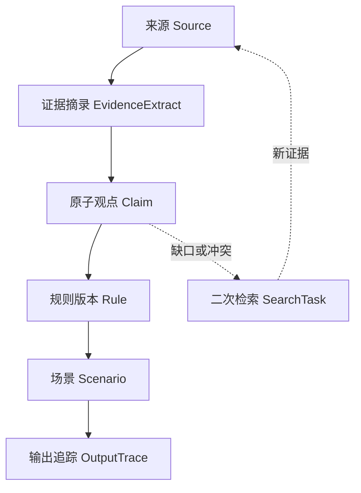

# Dr. Ferjoo 知识引用与全链路追踪规范

版本：0.1（设计草案）
适用范围：天然酵种诊断知识库、规则库、组合遍历、诊断输出与后续增量检索
配套 Schema：[`schemas/citation-bundle.schema.json`](schemas/citation-bundle.schema.json)

## 0. 决策摘要

Dr. Ferjoo 不应把“参考文献列表”直接附在规则文件末尾，而应维护 10 类可独立版本化的记录：

1. `source`：论文、权威网页、标准、数据集或内部资料的书目记录；
2. `evidenceExtract`：来源中可定位、可复核的最小证据摘录；
3. `claim`：一次只表达一个可判断真假的原子观点；
4. `conflict`：观点之间或证据之间的支持、限制与冲突；
5. `rule`：把输入条件映射为状态、风险和输出模板的可执行规则版本；
6. `outputTemplate`：可被证据追踪的最小输出句模板；
7. `scenario`：原始组合、合理性分类与叙事等价类；
8. `outputTrace`：一次真实或遍历诊断的不可变执行快照；
9. `searchTask`：证据缺口触发的二次检索任务及完整检索日志；
10. `review` / `auditEvent`：审校决定与不可覆写的变更审计。

核心原则是：**引用必须落到观点，观点必须落到规则，规则必须落到场景，最终每个输出句必须能反向追到规则版本、观点与证据定位。** 来源的书目等级不能替代“它是否直接支持当前这句话”的判断。



## 1. 对当前仓库的审阅结论

当前根目录静态应用已经有清晰的输入轴和规则顺序，但还不是可审计的“证据型规则系统”。

| 当前对象 | 仓库位置 | 已有内容 | 追踪缺口 |
|---|---|---|---|
| 输入枚举 | `starter-doctor.js`、`starter-doctor.browser.js` | 6 阶段、6 比例/种型、8 高度、7 温区，以及颜色、气味、经过时间等 | 没有字段定义版本、测量语义、适用范围 ID |
| 时间先验 | 两个引擎中的 `RATIO_BASE_HOURS`、`TEMPS` | 比例基准时间 × 温度系数 | 没有观点 ID、证据 ID、校准数据、置信度或高温外推标识 |
| 决策规则 | `isContaminated`、`applyStageOverride`、`applyActivityJudgment`、浏览器版 `applyElapsedContext` | 污染优先、阶段覆盖、成熟种活性、经过时间修正 | 没有稳定规则 ID；Node 与浏览器实现不一致；无法知道命中/覆盖了哪些规则 |
| 诊断结果 | `diagnoseStarter()` | `state`、`level`、`reasons[]`、`actions[]`、`safety[]` | 每句话都是裸字符串，无法逐句连接观点和引用 |
| 科学审校 | `KNOWLEDGE-AUDIT.md` | 5 个外部来源及若干“保留/修正/降级”判断 | 书目与判断混写；没有页码/章节；没有正反证、版本、审校状态 |
| 输出页面 | `app.js` | 原因、建议、安全提示和 pH 辅助卡片 | pH 文案在规则结果之外生成，仍属于未追踪的诊断输出 |

当前最重要的结构性风险不是“引用数量少”，而是**运行时结论与知识记录之间没有稳定连接点**。同一句文案被重写后，若没有模板 ID 与版本，历史结果就无法复现；同一来源被更正或撤回后，也无法计算哪些观点、规则、场景和输出受影响。

## 2. 采用的规范边界

本方案借用成熟规范的职责分工，但不声称 Dr. Ferjoo 的快速综述等同于医学系统综述：

- 书目元数据以 CSL-JSON 兼容字段为基础；展示层可渲染 GB/T 7714—2015、APA 7 等格式，**格式化字符串不是事实源**。[CSL 1.0.2](https://docs.citationstyles.org/en/stable/specification.html)
- DOI 论文优先用 Crossref 核验元数据和出版后更新；数据集/研究产出可用 DataCite 元数据。[Crossref REST API](https://www.crossref.org/documentation/retrieve-metadata/rest-api/)、[DataCite Metadata Schema 4.5](https://datacite-metadata-schema.readthedocs.io/en/4.5/)
- 检索日志字段参考 PRISMA-S 的可复现原则，记录信息源、平台、完整检索式、日期、限制、去重与补充检索，但内部产物应称“结构化快速综述”，除非未来完整满足相应综述方法。[PRISMA-S](https://doi.org/10.1186/s13643-020-01542-z)
- 证据—观点—规则—输出的来源关系借鉴 W3C PROV 的 `Entity / Activity / Agent` 思路；引用意图借鉴 CiTO 的“支持、反驳、扩展、采用方法”等关系。[W3C PROV-O](https://www.w3.org/TR/prov-o/)、[CiTO](https://sparontologies.github.io/cito/current/cito.html)
- 来源的更正、关注声明、撤回和更新优先核验 Crossmark/Crossref update metadata，并保留发布方通知链接。[Crossmark](https://www.crossref.org/services/crossmark/)
- JSON 文件使用 JSON Schema Draft 2020-12 校验。[JSON Schema 2020-12](https://json-schema.org/draft/2020-12)
- 审计哈希建议使用 RFC 8785 JSON Canonicalization Scheme 后计算 SHA-256，以避免键顺序导致哈希不一致。[RFC 8785](https://www.rfc-editor.org/rfc/rfc8785)

## 3. 标识符与版本规范

### 3.1 通则

- ID 一经发布不得复用；记录被淘汰时改状态，不删除或把 ID 分配给新对象。
- 稳定实体 ID 与版本分离。规则用 `ruleId + version`，输出模板用 `templateId + version`。
- ID 全部小写；前缀后用冒号分段；禁止把可变标题当唯一 ID。
- DOI 保存为去掉 `https://doi.org/` 后的小写形式；展示时再生成 DOI URL。
- 无全局持久标识符的网页使用规范化 URL 的 SHA-256 前 16 个十六进制字符；同时保存完整 URL、访问日期、页面更新时间和内容快照哈希。
- 内容哈希只用于完整性与去重，不能代替语义 ID。

| 实体 | 格式 | 示例 |
|---|---|---|
| 来源 | `src:<id-scheme>:<normalized-id>` | `src:doi:10.7554/elife.61644` |
| 无 DOI 网页 | `src:url:sha256-<16hex>` | `src:url:sha256-82be2f9fa6a48d31` |
| 证据摘录 | `evx:<source-short>:<locator-hash8>` | `evx:elife61644:7bc12d9e` |
| 原子观点 | `clm:<domain>:<slug>-<hash8>` | `clm:safety:colored-mold-discard-6f0caa19` |
| 冲突集 | `cfl:<domain>:<uuid>` | `cfl:temperature:018f...` |
| 规则 | `rul:<domain>:<slug>` | `rul:safety:visible-contamination` |
| 规则版本 | `<ruleId>@<semver>` | `rul:safety:visible-contamination@1.1.0` |
| 输出模板 | `tpl:<kind>:<slug>` | `tpl:action:discard-whole-starter` |
| 场景 | `scn:<axis-version>:<sha256-16>` | `scn:v1:1c4c77f42b06cd11` |
| 等价类 | `eqc:<rule-bundle>:<sha256-16>` | `eqc:rules-1.2.0:0cc4...` |
| 诊断追踪 | `run:<uuidv7>` | `run:0195...` |
| 检索任务 | `ret:<domain>:<uuidv7>` | `ret:temperature:0195...` |
| 审校记录 | `rev:<type>:<uuidv7>` | `rev:claim:0195...` |
| 审计事件 | `evt:<uuidv7>` | `evt:0195...` |

### 3.2 版本触发条件

- `MAJOR`：规则输入语义、优先级、安全决策或结论方向改变；
- `MINOR`：新增条件分支、输出模板或证据支持，不改变既有输入的预期安全方向；
- `PATCH`：书目修正、错字、同义改写，且遍历输出语义签名不变。

每次发布规则包必须记录 `ruleBundleVersion`、Git commit、规范化后的 bundle SHA-256、所用 Schema 版本和遍历报告 ID。不能只用 Git 行号作为来源关系，因为行号会变化。

## 4. 十类记录的字段设计

### 4.1 `source`：书目与出版状态

最低必填：

- `id`、`sourceType`、`title`、`language`；
- `identifiers`：DOI、PMID、ISBN、ISSN、ROR 等，能填则填；
- `csl`：CSL-JSON 兼容的作者、题名、容器、年份、卷期页、出版者；
- `canonicalUrl`；
- `issued`、网页类的 `accessedAt` 与 `pageUpdatedAt`；
- `metadataProvenance`：元数据来自 Crossref、DataCite、PubMed、发布方或人工录入，及核验时间；
- `publicationStatus`：`current / corrected / expression_of_concern / retracted / withdrawn / superseded / unknown`；
- `updateNotices[]`：通知类型、通知 DOI/URL、日期；
- `contentSnapshot`：快照时间、SHA-256、MIME、许可与存取说明；不默认保存受版权保护的全文。

来源类型只是筛选字段，不直接决定结论可信度。大学推广网页可能是家庭操作安全建议的直接来源，但未必能直接支持菌群机制；实验论文可能精确支持某个温度条件，却不能外推到所有家庭 starter。

### 4.2 `evidenceExtract`：最小可复核证据

一个摘录只对应来源中的一个局部证据单元：一句或相邻数句、一个表格单元、一个图结果或一段明确的方法说明。

必填字段：

- `sourceId`；
- `locator`：页码优先；网页用标题层级 + 段落指纹；必要时记录表、图、补充材料或时间戳；
- `paraphrase`：项目自己的准确释义；
- `quote`：仅在复核必要且许可允许时保存短引文，不批量复制全文；
- `studyContext`：研究对象、样本量、设计、干预/暴露、对照、终点、温度、含水量、面粉、接种量、实验或家庭环境；
- `limitations[]`：作者报告的限制与审校者识别的外推限制分开记录；
- `extractionMethod`、`extractedBy`、`extractedAt`、`verificationStatus`；
- `contentHash`：对“来源版本 + 定位 + 释义”的规范化哈希。

不允许用摘要中的一句宽泛结论支持正文才限定的阈值。数值阈值必须尽量定位到正文、表格或图，并记录单位、统计量和不确定性。

### 4.3 `claim`：原子观点

观点必须能独立判真伪，避免使用“温度影响发酵且 25–28℃ 最佳并且高温危险”这种把三项结论捆绑在一起的句子。应拆成至少三条。

关键字段：

- `text`：无修辞的单一命题；
- `claimType`：`descriptive / association / causal / mechanistic / threshold / temporal / safety / procedural / sensory`；
- `scope`：阶段、酵种类型、面粉、含水量、接种量、温度、经过时间、储存状态、使用场景、终点与明确排除项；
- `evidenceLinks[]`：证据摘录、立场和支持方式；
- `assessment`：来源质量、直接性、适用性、一致性、精确性、独立来源数及综合置信度；
- `status`：`draft / under_review / active / provisional / disputed / deprecated / withdrawn`；
- `reviewIds[]` 与 `conflictIds[]`。

#### 支持方式：必须三选一

| `supportMode` | 中文展示标签 | 判定标准 | 强制字段 | 可否单独支撑安全硬规则 |
|---|---|---|---|---|
| `direct` | 研究/权威资料直接支持 | 来源在相符范围内明确陈述或直接测量该命题 | 精确摘录定位、适用范围、立场 | 可以，但仍需质量与适用性门槛 |
| `inferred` | 基于证据推断 | 结论由一个或多个已支持前提推导，来源没有直接说出完整结论 | `premiseClaimIds`、推理链、假设、可证伪条件 | 不可作为唯一依据 |
| `experience` | 品牌经验 | 来自 Ferjoo 经验、内部观察、烘焙惯例或尚未外部验证的阈值 | 经验来源、样本/观察次数（未知也要写）、记录协议、外证检索状态 | 不可作为唯一依据 |

`stance` 与 `supportMode` 是两条轴：一篇论文可以用 `direct + challenges` 直接反驳观点，也可以用 `inferred + qualifies` 限制观点。

建议的 `stance`：`supports / challenges / qualifies / contextualizes / uses_method`。它与 CiTO 的思想兼容，但保留适合项目的较小词表。

### 4.4 多维证据评估，不使用单一“论文等级”

证据设计类型和结论置信度必须分开。建议记录：

**研究/资料设计 `designClass`**

- `systematic_review`：方法透明且纳入研究与当前问题相关的系统综述；
- `controlled_experiment`：有明确对照的发酵/微生物实验；
- `observational_study`：横断面、队列、生态或真实 starter 调查；
- `methods_or_validation`：测量/判据验证研究；
- `narrative_review`：叙述性综述；
- `authority_guidance`：政府、大学推广、标准机构的署名/审校指南；
- `expert_consensus`：透明的专家共识；
- `case_or_practice_report`：案例或实践报告；
- `brand_observation`：Ferjoo 内部经验；
- `unknown`。

**每个观点的评估维度**

| 维度 | 0 | 1 | 2 | 3 |
|---|---|---|---|---|
| `sourceQuality` | 无法核验/明显缺陷 | 关键方法缺失 | 基本可靠但有限 | 方法透明、同行评审或权威审校、更新状态已核验 |
| `directness` | 仅背景相关 | 需多步外推 | 小幅外推 | 对象、条件、终点直接匹配 |
| `applicability` | 与产品场景不相容 | 多个关键条件不同 | 部分匹配 | 与目标 starter 和家庭/烘焙场景高度匹配 |
| `consistency` | 多个可靠来源反向 | 单一或冲突未解 | 大体一致但有限 | 多个独立来源方向一致 |
| `precision` | 不可估计 | 范围宽/样本很小 | 有可用范围 | 精确估计且不确定性报告充分 |

综合 `confidence` 只允许 `high / moderate / low / very_low / unassessed`，并必须给出文字理由。禁止把上表简单相加后自动宣称“高置信”；安全规则须人工审校。

建议发布门槛：

- `danger` 或“弃用/食品安全”硬规则：至少一条 `direct` 的权威安全资料或适用的高质量研究，且两名审校者中至少一名具食品微生物/食品安全胜任力；不能只有 `inferred` 或 `experience`。
- 数值阈值与时间窗：必须标明对象、配方和温度等校准范围；范围外输出必须显示不确定性，不允许无标签线性外推。
- 普通操作建议：至少一个直接来源，或“多个直接前提 + 完整推理链”；品牌偏好可以保留，但必须显示“品牌经验”。
- 若有可靠反证未解决，观点状态为 `disputed`，规则不能按“确定事实”输出。

### 4.5 `conflict`：冲突、限制与撤回传播

冲突记录不能靠删掉不喜欢的论文解决。每个冲突集记录：

- 涉及的 `claimIds`、`evidenceExtractIds`；
- `conflictType`：定义差异、对象差异、条件差异、结果冲突、方法质量、时间更新、出版后更新；
- 可解释异质性：面粉、含水量、接种比例、starter 类型、温度、终点或家庭/实验环境；
- `status`：`open / explained_by_scope / resolved / unresolved / superseded`；
- 解决决定、保留的反证、审校人、日期与复审条件。

来源状态更新的自动传播规则：

| 来源事件 | 下游动作 |
|---|---|
| `corrected` | 开二次核验任务；比较被引用片段是否变化；受影响观点暂标 `under_review` |
| `expression_of_concern` | 受影响观点降为 `provisional`；安全硬规则若缺少独立支持则暂停 |
| `retracted` / `withdrawn` | 证据链接默认失效但不删除；重新计算观点置信度；阻断仅由该来源支持的已批准规则 |
| `superseded` | 保留旧版本用于历史复现；新规则不得继续默认引用旧版本，除非说明理由 |
| 网页内容哈希变化 | 进入“页面变化核验”队列；未复核前保留原快照和原定位 |

被撤回论文可以作为“该结论曾被提出但已撤回”的历史证据，不能继续以 `supports` 支撑活跃规则。

### 4.6 `rule`：可执行规则版本

规则记录不存大段自然语言判断，而包含：

- `ruleId`、`version`、`status`、`priority`、`safetyCritical`；
- `condition`：结构化 `all / any / not / predicate`，字段名只能来自已版本化的输入字典；
- `effect`：状态代码、严重度、原因/动作/安全输出模板 ID、是否覆盖低优先级规则；
- `claimIds[]`：支撑规则条件、阈值、结论和动作的观点；
- `applicability` 与 `uncertaintyPolicy`；
- `testScenarioIds[]`、审校记录和批准信息；
- `supersedesRuleVersionIds[]` 与变更理由。

规则 ID 代表语义身份，版本代表某次实现。`rul:timing:expected-rise-window@1.0.0` 与 `@2.0.0` 可以共存，历史输出必须保留当时实际运行的版本。

### 4.7 `outputTemplate`：逐句追踪，而非整段追踪

当前 `reasons[]`、`actions[]`、`safety[]` 里的每个裸字符串应迁移为模板。一个模板只表达一个观点或动作，例如：

```json
{
  "templateId": "tpl:action:continue-observation-until-window",
  "version": "1.0.0",
  "kind": "action",
  "language": "zh-CN",
  "textTemplate": "先观察到约 {expectedMin}，尽量不要中途再次喂养打断曲线。",
  "parameterNames": ["expectedMin"],
  "claimIds": ["clm:timing:early-observation-insufficient-1a2b3c4d"],
  "citationPolicy": "footnote",
  "disclosurePolicy": "show_inferred_or_experience"
}
```

以下内容也必须有模板 ID：状态名称、风险标签的解释、pH 卡片、时间卡片、安全免责声明；不能因为在 `app.js` 而绕过引用链。

### 4.8 `scenario`：组合合理性与等价类

场景保留原始输入和规范化输入，不能只保存压缩后的代表项。合理性分类建议固定为：

- `realistic`：常见或合理；
- `rare_plausible`：少见但理论与观测均允许，不能删除；
- `contradictory_requires_clarification`：输入在同一时点或语义上矛盾，先追问；
- `dominated_by_priority_rule`：污染等高优先级规则使其他轴不改变安全结论，可归并但仍要抽样测试；
- `out_of_scope`：超出工具定义或需实验室判断；
- `unknown_evidence_gap`：无法断言不可能，只能标为知识缺口并排队检索。

每个场景还要保存：

- `axisDefinitionVersion`；
- `equivalenceClassId`、是否代表项、类成员数；
- `ruleMatchSignature`：排序后的命中规则版本 ID + 覆盖关系；
- `outputSemanticSignature`：状态代码、严重度、模板 ID、支持模式，不用最终中文文案计算；
- 合并理由与反例；
- 预期命中规则/模板和人工核验状态。

**不能因为缺少论文覆盖就把组合标成“不可能”。** `contradictory` 必须能指出明确的输入定义冲突；“未见报道”属于 `unknown_evidence_gap`。

### 4.9 `outputTrace`：一次诊断的不可变快照

每次真实诊断和遍历运行都生成追踪记录，至少包括：

- `runId`、时间、引擎名/版本、Git commit、规则包版本与哈希；
- 原始输入、规范化输入、输入字典版本、场景 ID；
- 按优先级命中的规则版本、被覆盖规则及覆盖原因；
- 每个输出单元的最终文本、模板版本、参数、规则版本、观点、证据摘录、来源和支持方式；
- 适用性警告、证据置信度、知识缺口与检索任务 ID；
- 输出整体的审校状态。

用户界面可以只展示简洁脚注，但内部追踪不得只保存“[1]”。编号是某次渲染结果；永久关系必须保存 `sourceId` / `evidenceExtractId`。

示例（简化）：

```json
{
  "runId": "run:0195-example",
  "engine": {
    "name": "starter-doctor-browser",
    "version": "1.1.0",
    "gitCommit": "75e342f",
    "ruleBundleVersion": "rules-1.1.0",
    "ruleBundleHash": "sha256:..."
  },
  "normalizedInput": {
    "stage": "mature",
    "ratio": "1:1:1",
    "height": "none",
    "tempC": 26,
    "elapsedHours": 1
  },
  "matchedRuleVersionIds": [
    "rul:timing:early-observation@1.0.0"
  ],
  "outputUnits": [
    {
      "kind": "state_label",
      "text": "观察时间尚早",
      "templateVersionId": "tpl:state:early-observation@1.0.0",
      "ruleVersionIds": ["rul:timing:early-observation@1.0.0"],
      "claimIds": ["clm:timing:early-observation-insufficient-1a2b3c4d"],
      "evidenceExtractIds": ["evx:example:1234abcd"],
      "sourceIds": ["src:doi:10.xxxx/example"],
      "supportModes": ["inferred"],
      "confidence": "low"
    }
  ]
}
```

注意：上例 ID 和 DOI 仅演示结构，不是实际证据。

### 4.10 `searchTask`：二次检索队列

以下事件自动创建检索任务：

1. 活跃规则或输出模板没有任何 `direct` 证据；
2. 场景被标为 `unknown_evidence_gap`；
3. 数值阈值只由经验支持或适用性低于 2；
4. 有 `challenges` 证据但冲突未解决；
5. 来源被更正、关注、撤回、替代或网页哈希变化；
6. 高风险规则的最后一次证据状态核验超期；
7. 遍历出现新输出语义签名但无对应已审校模板；
8. 用户反馈与规则预测方向相反且达到预设重复次数。

任务按风险排序：食品安全/弃用误判 > 高温与保存 > 活性/成熟度 > 风味偏好。每个任务必须记录：

- 一个可回答的问题，而非关键词列表；
- 目标观点、规则、场景和输出模板；
- 纳入/排除标准、语言和日期边界；
- 每个数据库/网站、平台、完整检索式、检索日期、过滤器、命中数；
- 引文追踪、参考文献追踪、权威网站手工检索等补充方法；
- 去重方式、筛选计数、排除理由；
- 停止规则、关闭理由；
- `closed_no_evidence` 时明确“未找到”不等于“证明不存在”。

建议停止规则：预定核心数据库和权威机构均已检索；连续两轮关键词/引文扩展没有新增改变结论或适用范围的来源；冲突已能由范围差异解释，或明确记录为未解决；检索式和筛选流程可复现。

## 5. 审校状态机与职责分离

不同实体使用不同状态，不设一个模糊的全局 `approved: true`。

| 实体 | 建议状态 |
|---|---|
| 来源 | `metadata_unverified → metadata_verified → current/corrected/...` |
| 摘录 | `unverified → single_checked → double_checked → invalidated` |
| 观点 | `draft → under_review → active/provisional/disputed → deprecated/withdrawn` |
| 规则/模板 | `draft → evidence_review → scenario_validation → approved → deprecated/withdrawn` |
| 场景 | `generated → classified → reviewed → approved` |
| 检索任务 | `queued → searching → screening → extracting → review → closed_*` |

角色建议：

- `researcher`：检索、去重、提取；
- `domainReviewer`：核验观点、范围、推断链；
- `safetyReviewer`：核验食品安全规则；
- `ruleEngineer`：把已审校观点实现为条件和模板；
- `releaseApprover`：检查遍历、差异和门禁，不替代领域审校。

安全规则的证据提取者与最终批准者不得是同一人。AI 可以辅助检索、候选提取和一致性检查，但 `extractedBy` / `reviewedBy` 必须如实记录，AI 生成的摘录在人工复核前为 `unverified`。

## 6. 审计日志

`auditEvent` 采用只追加、不原地覆写的事件流。每次改变已发布实体都写：

- 谁在何时执行了什么动作；
- 目标实体 ID 与版本；
- `beforeHash`、`afterHash`；
- 变更理由、关联审校记录、检索任务或发布 ID；
- `previousEventHash` 与当前 `eventHash`，形成可验证链；
- 对用户可见影响：`none / wording / recommendation / safety`。

允许修正错误事件的方式是追加 `audit_event_corrected`，不得删除原事件。个人信息不应写入审计 diff；真实用户输入在保存前需脱敏，并遵循产品隐私策略。

## 7. 引文展示规范

### 7.1 内部记录

- 任何科学/安全/数值/机制/因果句都连接至少一个观点；
- 任何观点的证据关系都定位到摘录，不直接只连来源；
- 同一输出含两项不同命题时拆为两个输出单元；
- 直接引文保留原语言和精确定位；中文释义不能伪装成原文；
- 网页必须保存访问日期、更新时间（若有）和快照哈希；
- DOI、作者、年份由元数据核验后生成，不从搜索结果页直接抄录。

### 7.2 用户界面

建议默认用句末编号：`……[1]`，点击后显示：

- 完整书目、DOI/规范 URL；
- “直接支持 / 基于证据推断 / 品牌经验”标签；
- 与本场景的适用性说明；
- 证据置信度和最后核验日期；
- 有争议或已更新时显示醒目标识。

同一来源在一次报告中只分配一个展示编号，但同一来源下的不同摘录仍保留各自内部 ID。参考文献列表建议以 GB/T 7714—2015 顺序编码制作为中文默认，并允许切换 APA；两者均从 CSL 数据生成。

## 8. 与遍历流程的结合

每个代表场景执行用户要求的三步：

1. **核验**：比较实际输出与场景的预期规则/模板；检查阶段、时序、风险和叙述是否自洽；
2. **检索**：解析所有输出单元的观点和证据；缺失、低置信、冲突或过期即创建 `searchTask`；补证后必须重新审校观点，而不是直接改文案；
3. **重写**：只通过新版本 `outputTemplate` 改写；保留旧版本；重新跑等价类代表项与边界反例。

等价类合并应发生在“规则命中语义”层，而不是仅按中文结果字符串。两个场景只有在以下内容全部相同时才能暂定为同类：

- 最高优先级命中规则；
- 所有未被覆盖的规则版本；
- 状态代码与严重度；
- 输出模板 ID 集合；
- 支持方式和适用性警告；
- 后续动作顺序。

类内至少保留边界值、最常见值和随机成员做回归；安全规则覆盖的组合不能完全跳过，只能减少重复的叙事审校。

## 9. 发布门禁

一次规则包发布必须全部通过：

1. JSON Schema 校验；
2. 全局 ID 唯一、外键可解析、无失效版本引用；
3. 已批准观点至少一个有效证据链接，或明确为 `experience + provisional`；
4. 活跃规则只引用 `active/provisional` 观点，不引用已撤回来源作为正向证据；
5. 安全规则满足双人审校和直接证据门槛；
6. 每个规则效果中的模板均存在，每个模板均至少连接一个观点或明确标为纯导航/免责声明；
7. 所有代表场景、边界反例和污染优先级组合通过；
8. Node、浏览器或未来服务端对相同规范化输入产生相同语义签名；
9. 与上个规则包的场景差异报告已审阅，特别标出 `level`、弃用建议和时间阈值变化；
10. 来源状态核验无未处理的撤回、关注或网页内容变化；
11. 审计事件链和规则包哈希完整；
12. 仍未解决的知识缺口在输出中有不确定性提示，并进入检索队列。

## 10. 建议目录与迁移顺序

建议未来目录（本文件不创建运行时数据）：

```text
research/
  citation-system.md
  schemas/
    citation-bundle.schema.json
  data/
    sources.json
    evidence-extracts.json
    claims.json
    conflicts.json
    search-tasks.json
    reviews.json
  protocols/
    search-protocol-v1.md
  snapshots/
    web/
rules/
  definitions.json
  output-templates.json
scenarios/
  axis-definitions.json
  catalog.json
traces/
  traversal-runs/
audit/
  events.jsonl
```

迁移按四步进行：

1. **冻结基线**：给当前两个引擎、每条逻辑分支和每个输出句分配 ID；记录当前 commit 与 2,016 个核心组合的语义输出，不先假装已有科学支持。
2. **拆观点并标债务**：把 `KNOWLEDGE-AUDIT.md` 和现有裸字符串拆成原子观点；未找到直接证据的先标 `experience/provisional` 并创建检索任务。
3. **接入规则与模板**：建立单一规则源，使浏览器/Node 从同一规则包构建；运行时返回规则版本和输出模板 ID。
4. **开启可审计遍历**：按合理性分类和等价类压缩；逐类执行核验—检索—重写；把每次运行保存为 `outputTrace`，以发布门禁阻止无证据或不一致结果进入正式版本。

## 11. 最小可交付定义

当以下查询都能由机器回答时，引用系统才算真正落地：

- “`>32℃` 的建议由哪些论文或权威资料直接支持？适用于哪些 starter、温度和终点？”
- “这句‘继续观察’是哪个规则版本触发的？为什么覆盖了‘活性不足’？”
- “某篇论文被撤回后，哪些观点、规则、组合和历史报告受影响？”
- “一个边缘组合为何被归并、要求澄清或列为知识缺口？”
- “某条品牌经验是否已完成外部检索？无证据结论如何向用户披露？”
- “同一输入在规则包升级前后为什么改变，改变是否经过证据与场景审校？”

配套 Schema 定义了上述记录的机器可校验字段。它是数据边界，不替代领域审校、统计判断或食品安全责任。
