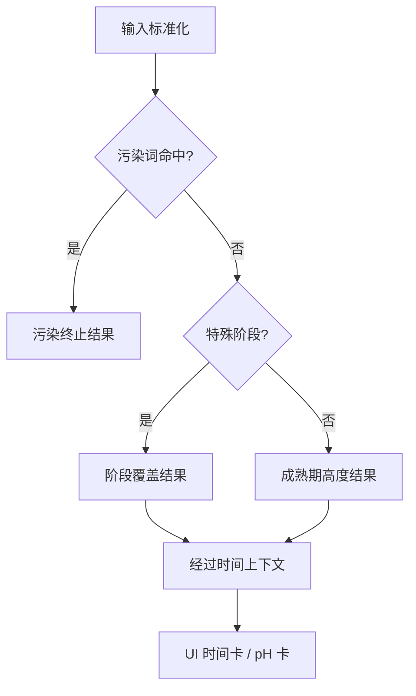

# Dr. Ferjoo 有限场景模型、组合归并与遍历规范

> 状态：设计建议，不修改现有运行时代码
> 审阅对象：`starter-doctor.browser.js`、`starter-doctor.js`、`app.js`、`index.html`
> 目标：把“遍历所有输入”改造成可证明覆盖、不会误删罕见真实案例、能够持续吸收证据的有限场景审阅流程。

## 1. 结论先行

1. 当前产品并非严格意义上的有限输入系统。结构化控件是有限的，但“一句话输入”和备注是无限字符串域；正确做法是分为“有限语义遍历”与“文本解析/污染触发词测试”两条管线。
2. 核心四轴是 `6 阶段 × 6 比例 × 8 高度 × 7 温度桶 = 2,016` 个组合。对当前浏览器引擎实测，这 2,016 个组合得到 54 个逐字不同的诊断正文，或 17 个不同的“状态＋等级”。这说明可以压缩，但 54 和 17 都只能描述**当前引擎等价**，不能证明领域上等价。
3. 若机械相乘当前 UI 的所有离散控件：`6 × 6 × 8 × 34 × 50 × 8 × 7 × 47 = 1,288,627,200`。其中温度为“默认 + 8–40℃整数”共 34，经过时间为“默认 + 0–48 小时整数”共 50，颜色 8，气味 7，pH 为“空 + 2.5–7.0、步长 0.1”共 47。这个十亿级数字主要来自重复表达，并不等于十亿个知识场景。
4. 合法 UI 元组本身几乎没有可由当前字段单独证明的“物理不可能”组合。很多看似荒谬的组合实际只是缺少“测量基线、温度指向、是否刚搅匀、是否观察到峰值”等上下文。它们应进入“需澄清”，而不是直接删除。
5. “少见但可能”必须保留；“理论未覆盖”是证据缺口，不是“不可能”。可压缩的是重复计算，不应压缩掉风险、边界和知识空白。
6. 推荐用三种等价关系并存：`引擎等价`、`证据等价`、`审阅等价`。只有证据等价成立时才允许共享最终观点与建议；仅引擎等价的组合要作为规则盲区候选保留反例。

## 2. 源码事实与现有判断顺序

浏览器运行时的输入枚举位于 `starter-doctor.browser.js:8-55`；污染判断位于 `:142-148`；阶段覆盖位于 `:179-257`；成熟期高度判断位于 `:259-328`；经过时间修正位于 `:330-352`；总入口位于 `:354-390`。UI 的温度、时间、颜色、气味、pH 控件分别在 `index.html:120`、`:135`、`:146`、`:159`、`:179`，组装输入与附加卡片在 `app.js:50-107`。

当前实际控制流是：



需要特别记录的实现事实：

- 污染是终止规则，覆盖阶段、比例、高度、温度和经过时间的诊断意义。
- `start_d1`、`start_active`、`start_stable`、`fridge`、`revive` 都由阶段规则接管；只有 `mature` 进入通用高度判断。
- 经过时间仅会重写成熟期且高度为 `none/slight` 的主诊断；非污染结果还会显示 UI 时间卡。污染分支在时间修正前提前返回，因此即使输入了经过时间，当前也不会显示该卡。
- pH 不进入 `diagnoseStarter`，只由 `app.js` 生成辅助卡。
- 正常颜色、正常气味、灰白液层、果香、酒精味不改变主诊断；备注只有命中污染正则时才改变结果。
- Node 版 `starter-doctor.js` 不包含浏览器版的经过时间规则。任何正式遍历必须先选定唯一运行时或做前后端差异门禁，不能混用两个函数的输出作为同一真值。

### 2.1 当前 2,016 核心组合的实测压缩

固定无污染、无经过时间、无 pH，仅遍历阶段、比例、高度、温度桶：

| 指纹 | 类数 | 含义 | 是否可直接用于领域归并 |
|---|---:|---|---|
| 完整输入元组 | 2,016 | 四轴笛卡尔积 | 否；大量重复 |
| `state + level + reasons + actions + safety` 逐字指纹 | 54 | 当前浏览器引擎正文相同 | 否；可能是规则未使用某轴 |
| `state + level` | 17 | 粗粒度结果相同 | 否；过度压缩 |
| 建议的结构规则模板 | 约 20–22 | 去除时间数字占位符后按控制分支归并 | 只适合执行覆盖，不足以替代证据审阅 |

“54”可用以下定义重复计算：对每个核心元组调用浏览器版 `diagnoseStarter`，再对 `{state, level, reasons, actions, safety}` 做稳定 JSON 序列化与去重。它是版本相关基线，不是永久指标。

## 3. 两层场景空间

### 3.1 有限语义层

将一次诊断定义为：

\[
x=(s,r,h,t,e,c,o,p,n,q)
\]

其中：

| 字段 | 语义 | 当前有限域 / 建议域 |
|---|---|---|
| `s` | 阶段 | 6 个 `STAGES` |
| `r` | 投种:面粉:水/种型 | 6 个 `RATIOS`；不可只按预期时间归并，硬种应保留独立身份 |
| `h` | 当前高度/形态 | 8 个 `HEIGHTS` |
| `t` | 当前温度 | 原始数值或默认；规范化为 7 桶，但保留边界原值 |
| `e` | 本轮喂养后经过时间 | 缺失或非负数；派生为相对预期时间桶 |
| `c` | 颜色观察 | 触发词来源 + `neutral/gray-liquid/suspect` 语义 |
| `o` | 气味观察 | 触发词来源 + `neutral/fruity/alcohol/suspect` 语义 |
| `p` | pH | 缺失、无效、`<3.3`、`3.3–3.8`、`(3.8,4.6)`、`≥4.6` |
| `n` | 备注的语义特征 | `none / bad-smell / bad-color / both`，另保留具体触发词覆盖 |
| `q` | 观测质量/语义限定 | 见下文；这是识别矛盾所必需、但当前 UI 缺失的元数据 |

建议给 `q` 增加至少以下字段，不一定立刻展示给所有用户，可在冲突时追问：

```ts
type ObservationContext = {
  elapsedPrecision: 'exact' | 'rounded' | 'unknown';
  heightBaseline: 'marked-after-mixing' | 'old-mark' | 'unknown';
  temperatureRef: 'starter-core' | 'ambient-now' | 'storage-setting' | 'unknown';
  currentLocation: 'fridge' | 'room' | 'warming' | 'unknown';
  peakObservedThisCycle: true | false | 'unknown';
  stageEvidence: 'calendar-age' | 'maintenance-history' | 'self-label' | 'unknown';
};
```

### 3.2 无限文本层

`naturalInput` 与 `notes` 不能做笛卡尔积。它们应单独测试：

1. 每个标准值、别名、污染正则 token 的逐项覆盖；
2. 最长别名冲突，例如“不翻倍”不能被“翻倍”吞掉；
3. 多实体同句、否定、引用、假设、错别字、全半角、单位变体；
4. 基于有限语义元组生成多种表述，再检查解析后是否回到原元组；
5. 对备注只抽取明确可解释的有限特征，原文保留供审计，不参与组合相乘。

## 4. 分类不能用单一“删/留”标签

每个场景应同时拥有四个正交标签，然后再决定遍历处置。这样可避免把“少见”“当前被覆盖”“理论未覆盖”误当成“不可能”。

```ts
type ScenarioClassification = {
  validity: 'valid' | 'schema-invalid';
  consistency: 'consistent' | 'hard-conflict' | 'needs-clarification';
  plausibility: 'common' | 'rare-plausible' | 'evidence-unknown';
  dominance: 'safety-terminal' | 'stage-override' | 'activity-rule' | 'auxiliary-only';
  influence: string[];       // 实际影响结果的字段
  blindAxes: string[];       // 当前无影响、但领域上可能应有影响的字段
};
```

最终处置优先级：

1. `schema-invalid`：拒绝执行，记录输入契约测试；
2. `hard-conflict`：不生成常规诊断，给出矛盾点与重新测量动作；
3. `needs-clarification`：进入最小追问，不擅自选择解释；
4. `safety-terminal`：立即执行安全终止规则；
5. `evidence-unknown`：可生成保守结果，但必须登记证据缺口；
6. `rare-plausible`：保留遍历，降低批次优先级而非删除；
7. 其余进入常规代表场景与边界遍历。

### 4.1 物理矛盾 / 输入契约错误

必须有可验证前提才能标成“物理矛盾”。对当前 UI 的合法元组，**不建议预先声明任何 `(stage, ratio, height, temp)` 四轴组合绝对不可能**。原因是字段缺乏时间和测量语义：例如冷藏阶段看到 3 倍高度，可能是入冰箱前已经涨高；高温下仍看到活性，可能只是短时暴露；起种早期突然大涨可能是非稳定菌群活动或阶段填错。

可证明的硬冲突例子依赖 `q`：

- 若 `e=0` 被确认是“刚完成彻底混合的精确时刻”，且高度基线也是刚标记，则 `h != none` 与定义冲突。若这两个前提未确认，只能追问，不能删除。
- 若 `h=fallen` 被定义为“本轮从已观察峰值回落”，但用户同时确认本轮从未出现过峰值、标记没有沿用，则语义冲突；当前 UI 没有后一个字段，故默认只能追问。
- 负经过时间、非法比例、未知枚举、非数值温度/pH 属于 schema-invalid，而不是领域场景。

硬冲突场景也不能静默丢弃；它们的正确产出是“无法核验—请重测/澄清”，并计入冲突处理覆盖率。

### 4.2 需澄清组合

建议的首批澄清规则：

| 条件 | 为什么不能直接判不可能 | 最小追问 |
|---|---|---|
| `e=0` 且 `h` 为明显上升/回落/液层 | 0 可能代表“小于 1 小时”或旧刻度 | “0 小时是刚搅匀的精确时刻，还是不足 1 小时？高度基线何时标记？” |
| `s=fridge` 且当前温度明显高于冷藏温区 | 可能刚取出、冰箱失温、温度指环境而非样品 | “酵种此刻仍在冰箱，还是已取出回温？” |
| `s=fridge` 与明显上涨/回落 | 可能入冷藏前已经上涨 | “这个高度变化发生在入冰箱前还是冷藏期间？” |
| `s=revive` 且 `e` 缺失 | 无法区分刚取出与连续刷新后仍不动 | “已经回温/刷新了几次，每次经过多久？” |
| `h=fallen` 且没有峰值证据 | “回落”需要本轮基线或历史观测 | “本轮最高点是多少、何时出现？” |
| pH 与阶段/活性明显不协调 | 仪器校准、取样方式和刚喂后稀释会改变读数 | “何时测量、仪器是否校准、是否刚喂后测？” |
| 多个安全信号互相不一致 | 例如选择正常颜色但备注写“有绿斑” | 以安全优先临时处置，同时确认是否为当前样品、是否为否定句/引用 |

### 4.3 少见但可能

以下组合只能标记为 `rare-plausible` 或 `evidence-unknown`，不能剪枝：

- 起种第 1–2 天但出现 `peak_plus/over3/fallen`；
- 冷藏阶段保留 `peak_plus/over3/fallen` 的体积形态；
- 复活期同时出现液体层；
- `>32℃` 下仍观察到明显上涨；
- 成熟自报、明显上涨，但 pH 辅助值偏高；
- 灰白液层、酒精味与强活/回落等表面矛盾的观察组合。

这些例子可能来自短时状态、测量时点、维护历史、样品差异或填报误差。只有权威证据明确给出必要条件，且产品补齐相应观测字段后，才可升级为 hard-conflict。

### 4.4 高优先级覆盖

当前污染集合：

- 颜色/备注正则：`粉红|橙|黑|绿|发霉|霉斑|长毛|变色`；
- 气味/备注正则：`腐臭|氨味|霉味|馊味`。

任一命中即进入 `safety-terminal`。归并时：

- 所有下游四轴可用一个主代表结果复用，避免重复重写；
- 每个具体触发词仍需至少一个正例、否定/引用反例和组合正例，不能只测“粉红”；
- 至少对每个阶段分支和每个高度结果做污染优先级的变形测试：加入污染信号后必须转为安全终止；
- 被覆盖的下游字段不是“非法”或“无价值”，只是对**当前终止诊断**不再改变结论。

UI 枚举中，颜色 8 项有 5 项触发污染，气味 7 项有 3 项触发污染；默认备注无触发词时，`8 × 7 = 56` 个颜色/气味配对中有 44 个被污染终止覆盖，只有 12 个保持非污染路径。44 个无需与十亿级其他控件全相乘重写，但需完成触发源覆盖和优先级性质测试。

### 4.5 对当前规则无影响

“无影响”必须写清作用域：主诊断、附加卡、指标回显或文本解析。

| 轴/变化 | 当前主诊断 | 完整 UI | 处置 |
|---|---|---|---|
| pH 各区间 | 无影响 | pH 卡变化 | 独立遍历 pH 边界，不与核心全相乘 |
| 非污染颜色/气味 | 无影响 | 仅输入保留 | 归并为语义组，但每个显示项做值覆盖 |
| 非触发备注文本 | 无影响 | 不展示在报告 | 做解析/否定测试，不进笛卡尔积 |
| 同一温度桶内不同整数 | 无影响 | 标签/系数相同，输入值不回显 | 中点代表 + 所有分界两侧边界 |
| 非成熟阶段的经过时间 | 不重写主诊断 | 时间卡随关系变化 | 主诊断归并、卡片单独遍历 |
| 阶段覆盖路径中的比例/温度 | 正文通常不变 | 比例、温度、预期时间指标变化 | 不能完全删；保留指标一致性和边界代表 |
| 成熟期 `near/double/peak_plus/over3/fallen/hooch` 的比例/温度/经过时间 | 正文不变 | 指标和时间卡变化 | 标记为当前盲轴，做证据审阅样本 |
| `start_stable` 中 `none/slight/near/over3/fallen/hooch` | 当前正文相同 | 高度输入不同但报告不区分 | 仅“引擎等价”，是高价值规则盲区候选 |

最后一行尤其重要：输出不变可能是合理覆盖，也可能是不完善。不可仅用哈希相同就批量认定“科学上同一场景”。

## 5. 三层等价关系与归并键

### 5.1 引擎等价 `~E`

在固定规则版本 `v` 下，若两个输入产生同一规范化输出，则：

\[
x \sim_E y \iff CanonicalOutput(F_v(x)) = CanonicalOutput(F_v(y))
\]

建议 `CanonicalOutput` 使用规则 ID/消息模板 ID，而非中文逐字文本。当前尚无 ID 时可临时用：

```ts
K_engine = hash({
  runtime: 'browser',
  state, level,
  reasons: normalizeTimePlaceholders(reasons),
  actions: normalizeTimePlaceholders(actions),
  safety,
  expectedRange,
  elapsedRelation,
  phCardBand
});
```

不要把 `stageLabel/ratioLabel/tempLabel` 等纯回显字段混入“规则正文等价”，但完整 UI 快照测试应另有 `K_view` 包含这些字段。

### 5.2 证据等价 `~D`

只有当证据库支持两个场景共享相同的“机制、风险、判断阈值、动作与适用限制”，才满足领域/证据等价：

\[
x \sim_D y \iff Claims(x)=Claims(y) \land Actions(x)=Actions(y) \land Limits(x)=Limits(y)
\]

`~D` 必须由审阅记录支持，不能从当前代码输出反推。

### 5.3 审阅等价 `~R`

用于控制工作量的保守键：

```ts
K_review = [
  safetyClass,          // none | bad-color | bad-smell | both
  safetyTriggerFamily,  // 首轮保留具体 token 家族
  stageBranch,
  ratioId,              // 六个比例先不合并
  heightEvidenceGroup,
  tempBucket,
  elapsedRelation,      // missing | pre-window | in-window | post-window
  phBand,
  observationIntegrity, // sound | clarify | conflict
  evidenceProfile       // supported | gap | disputed
];
```

合并最终撰写任务的充分条件建议为：`x ~E y` 且 `x ~D y` 且关键边界性质一致。若只有 `~E`，共享执行结果但保留至少一个“盲轴反例”进入人工核验。

### 5.4 当前阶段分支键

当前浏览器代码可直接提取以下 `stageBranch`：

| 阶段 | 分支键 |
|---|---|
| `start_d1` | `hooch` / `other` |
| `start_active` | `none_or_slight` / `other` |
| `start_stable` | `double_or_peak_plus` / `other` |
| `fridge` | `hooch` / `other` |
| `revive` | `double_or_peak_plus` / `other` |
| `mature` | 8 个高度各自保留；`none/slight` 再乘相对时间分支 |

相对时间派生：

```ts
function elapsedRelation(e, min, max) {
  if (e == null) return 'missing';
  if (e < min) return 'pre-window';
  if (e > max) return 'post-window';
  return 'in-window'; // min、max 本身均在窗口内
}
```

注意当前主诊断在 `e == min` 处从“继续观察”突变为原始 `danger/warn`；这是需要证据核验的边界，不应在归并中隐藏。

## 6. 代表场景选择

每个 `K_review` 不只选一个“平均值”，而选最多四类见证：

1. **典型代表**：默认/中位输入，供观点核验与重写；
2. **下边界见证**：温度桶、时间窗、pH 阈值的左侧与阈值点；
3. **上边界见证**：阈值点与右侧；
4. **盲轴反例**：当前输出相同、但领域上可能应该不同的两个输入。

温度边界至少覆盖 `15, 18, 22, 25, 28, 32℃` 的两侧及等号归属。由于当前实现是 `<15, <18, <22, <25, <28, <=32, >32`，测试值应包含整数 UI 的 `14/15`、`17/18`、`21/22`、`24/25`、`27/28`、`32/33`；API 还应补小数 `14.9/15.0` 等。

时间边界对每个 `ratio × tempBucket` 动态生成：`missing, 0, min-ε, min, min+ε, max-ε, max, max+ε, 48`，再裁剪到 UI 范围。UI 整数测试用 `floor/ceil` 选择可达代表；API 测试保留小数边界。

pH 边界至少覆盖 `missing, 2.5, 3.2, 3.3, 3.8, 3.9, 4.5, 4.6, 7.0`，另测 UI 之外的无效值与非数值输入。

## 7. 推荐遍历顺序

### 第 0 层：契约与运行时一致性

1. 锁定唯一规则版本和浏览器/Node 真值来源；
2. 校验每个枚举可达、默认值明确、标准化幂等；
3. 对同一结构化输入做两运行时差分；任何无法解释的差异先阻断知识遍历；
4. 固定规则内容哈希、证据库版本和生成时间，使遍历可复现。

### 第 1 层：安全终止

1. 每个颜色、气味、备注污染 token 单独命中；
2. 每个 token 的否定、引用、假设反例；
3. `bad-color × bad-smell` 组合；
4. 对每个下游阶段分支加入一个污染信号，验证污染优先；
5. 完成安全正文、弃用动作与来源证据审阅后，再进入普通活性建议。

### 第 2 层：澄清与冲突

先跑 `e=0 + 非none高度`、`fridge + 高温`、`fallen + 峰值未知`、pH/阶段不协调等场景。目标不是强行诊断，而是验证：系统是否识别歧义、追问是否最小、未澄清前是否避免过强结论。

### 第 3 层：阶段覆盖

按 `start_d1 → start_active → start_stable → revive → fridge` 的分支键遍历。每个分支先用 `1:1:1、25–28℃、时间缺失` 代表完成核验/检索/重写，然后增加：

- 六个比例的值覆盖；
- 温度边界；
- 高度同组盲轴反例；
- 时间卡边界；
- 少见但可能的尾部组合。

### 第 4 层：成熟期活动曲线

按自然状态顺序而非枚举字典顺序：

`none → slight → near → double → peak_plus → over3 → fallen → hooch`。

`none/slight` 优先遍历 `pre-window/in-window/post-window`；其他高度先审阅比例/温度是否真的只应影响时间指标，再决定领域归并。

### 第 5 层：比例 × 温度 × 时间边界

对 42 个 `ratio × tempBucket` 生成动态时间边界见证。高温 `>32℃` 不应仅作为“更快系数”常规延伸；在权威证据审阅完成前，将其独立置于风险/证据缺口队列，不与 `28–32℃` 合并。

### 第 6 层：辅助观测

pH、非污染颜色/气味、灰白液层和酒精味采用条件覆盖/成对覆盖，不与所有核心轴全相乘。每个辅助变量至少与：早期、成熟活跃、成熟无反应、回落/饥饿、冷藏五种代表上下文配对。

### 第 7 层：文本与回归

从已审阅的有限场景生成自然语言变体，验证解析→规范化→诊断→引用→重写闭环；加入否定、矛盾、多信号、中文数字、全半角、单位和错别字扰动。

### 队列内排序

同一层按以下评分从高到低：

\[
Priority = 5\cdot Safety + 4\cdot Severity + 3\cdot CoverageGain + 2\cdot EvidenceGap + Boundary + RarityWitness
\]

`RarityWitness` 只用于保证罕见案例不饿死，不表示罕见案例比安全案例更先。

## 8. 每个代表类的“核验—检索—重写”记录

建议每个 `K_review` 形成不可变审阅单：

```yaml
scenario_class_id: SCN-MATURE-NONE-PREWINDOW-001
rule_version: <git-sha>
representatives: []
boundary_witnesses: []
counterexamples: []
classification:
  consistency: consistent
  plausibility: common
  dominance: activity-rule
current_output_fingerprint: <hash>
claims:
  - claim_id: CLM-...
    statement: "..."
    evidence_ids: [REF-...]
    applicability: "..."
    confidence: high|moderate|low|gap
verification:
  correctness: pass|revise|blocked
  completeness: pass|revise|blocked
  narrative: pass|revise|blocked
rewrite:
  state: "..."
  rationale: []
  action_now: []
  observe_until: "..."
  escalation: "..."
  citations: []
status: queued|verified|rewritten|approved|blocked
```

重写必须体现当前阶段和相对时间，不要让“未到观察窗口”与“超过窗口仍不动”共享同一建议。每条动作应写出动作、时点/持续时间、重新观察指标和升级条件。

## 9. 覆盖指标

最低门禁建议：

| 指标 | 定义 | 目标 |
|---|---|---:|
| Schema value coverage | 每个有限枚举/默认值至少出现一次 | 100% |
| Rule branch coverage | 污染、阶段子分支、8 高度、时间重写分支 | 100% |
| Review-class coverage | 每个可行 `K_review` 至少一个批准代表 | 100% |
| Boundary coverage | 所有温度、时间、pH 阈值的左/点/右 | 100% |
| Safety trigger coverage | 每个正则 token 的正例与反例 | 100% |
| Dominance coverage | 每个安全触发家族覆盖所有下游分支家族 | 100% |
| Metamorphic coverage | 声明的“不变/应变”性质都有见证对 | 100% |
| Clarification coverage | 每类歧义都有追问与澄清后两条路径 | 100% |
| Rare-case registry | 所有 rare/unknown 均被审阅或显式阻塞 | 100% 登记，0 个静默丢弃 |
| Citation coverage | 每个可外部核验的核心观点绑定证据 ID | 100% |
| Applicability coverage | 每条观点记录对象、温度、基质、阶段等限制 | 100% |
| Runtime parity | Node/浏览器对共同契约的结构化输出一致 | 100%，或差异均有批准说明 |
| Unexplained collision | 领域上预期不同却被归并且无说明 | 0 |
| Unexplained split | 证据等价却输出不同且无说明 | 0 |

建议额外跟踪：每一轮新增证据导致的类拆分/合并数、建议改动数、证据缺口年龄、规则覆盖但无证据的分支数。

## 10. 变形性质与反例

以下反例能防止“为了减少组合而掩盖问题”。

### 10.1 污染覆盖不是普通等价

```json
{"stage":"mature","ratio":"1:1:1","height":"double","temp":26,"color":"粉红"}
```

即使高度为翻倍，也必须进入污染终止结果。它可以和其他污染输入共享核心安全正文，但仍需记录触发源为粉红色，不能把原输入抹掉。

### 10.2 时间边界会改变结论

对成熟期、`1:1:1`、25–28℃、`height=none`：当前最早窗口为 4 小时。

- `elapsed=3` → “观察时间尚早 / info”；
- `elapsed=4` → “活性不足 / danger”。

两者只差一个小时，却不能归并；同时这个突变本身必须由证据审阅，不可只因代码如此就接受。

### 10.3 当前无影响可能是规则盲区

`start_stable + height=none` 与 `start_stable + height=fallen` 当前都进入“尚未成熟”同一正文。前者表示尚未上升，后者表示本轮已上升并回落，机制和下一步可能不同。二者属于 `~E`，但在证据确认前不属于 `~D`；必须保留为盲轴反例。

### 10.4 少见不等于不可能

`start_d1 + peak_plus` 看起来不符合“成熟种曲线”，但可能是阶段填写边界、早期短暂强活动或旧刻度造成。当前字段无法证明不可能，应先澄清起种时长、标记和是否刚喂，而不是剪枝。

### 10.5 冷藏与高度不能机械判冲突

`fridge + over3` 可能代表入冰箱前已经涨到该高度，或温度/阶段的指向不一致。正确处置是询问变化发生时间和当前位置；只有确认“从彻底混合的冷藏基线开始、全程冷藏、时间与测量可靠”后，才讨论其罕见性。

### 10.6 同温度桶是执行等价，不一定是科学等价

25℃ 与 27℃ 当前都落入 `t_25_28`，输出相同。可用同一代表跑正文模板，但边界/证据审阅仍需保留实际温度；不能宣称二者发酵行为完全相同。

### 10.7 正常词与污染词组合验证优先级

`color=正常米白, smell=腐臭` 和 `color=粉红, smell=果香` 均应污染终止。任何一个正常辅助信号都不能抵消明确污染触发。

### 10.8 否定文本是污染正则反例

备注“没有粉红色、没有霉味”会被当前简单正则判污染。这不是安全覆盖的正常成功，而是文本理解反例。遍历器应把“结构化明确选择”与“自由文本 token 命中”分开记录，避免用污染终止类掩盖误报。

## 11. 停止规则

一次全量规则审阅只有同时满足以下条件才可停止：

1. 所有 schema 值、控制分支、审阅类、阈值边界均达到目标覆盖；
2. 所有安全触发源完成正例、反例、优先级验证；
3. 所有 `needs-clarification` 类都有最小追问和澄清后的确定路径；
4. 所有 `rare-plausible/evidence-unknown` 均被批准、拆分类或显式标记 blocked，不存在静默剪枝；
5. 同一 `K_review` 内无未解释输出分裂，不同领域类间无未解释输出碰撞；
6. 每个核心判断与动作都有可追溯证据或明确的“品牌经验/待证实”标签；
7. Node/浏览器或未来服务端/客户端的共同契约差异为零；
8. 连续两次完整遍历没有产生新的规则分支、类拆分、未引用核心观点或高风险反例；
9. 所有测试结果绑定规则版本和证据库版本，可重复运行。

“连续两轮无新增”只能作为饱和信号，不能替代前七项硬门禁。发现新证据、修改枚举、阈值、规则优先级或建议正文时，应只失效受影响的审阅类及其依赖，而不是盲目重跑人工全文审阅。

单个类可标记完成的条件：核验通过；所有核心观点有证据/缺口标签；正文包含当前阶段、时间上下文、立即动作、观察点、升级条件；边界见证和反例均通过。

## 12. 建议的首轮最小遍历包

不需要先跑十亿组合。首轮可按以下有限包启动：

1. 2,016 个核心组合自动执行，建立 54 正文指纹/17 状态等级基线；
2. 结构控制分支约 20–22 个典型代表做人工“核验—检索—重写”；
3. 42 个 `ratio × tempBucket` 各自生成时间边界见证，重点覆盖成熟 `none/slight`；
4. 12 个污染 token 的逐项正例、否定反例，以及与所有下游分支的优先级变形测试；
5. 9 个 pH 边界值 × 5 个代表上下文；
6. 每个阶段分支至少一个当前无影响轴反例；
7. 本文列出的 8 组澄清/罕见/否定反例；
8. 浏览器版与 Node 版共同输入的全量差分报告。

完成这批后，根据证据审阅拆分 `K_review`。只有新证据证明多个类的机制、阈值、动作和适用限制均相同，才进一步合并；若证据显示差异，则宁可增加有限类，也不要用当前代码的相同输出覆盖差异。

## 13. 后续实现接口建议（非本次代码修改）

未来遍历器建议输出四份机器可读产物：

- `scenario-catalog.jsonl`：规范化输入、派生特征、分类标签、归并键；
- `scenario-results.jsonl`：规则版本、完整结构化输出、正文/视图指纹；
- `scenario-review.yaml`：观点、证据、核验、重写与审批状态；
- `scenario-diff.md`：新增/消失类、碰撞、分裂、边界变化、运行时差异。

为规则添加稳定 `ruleId/reasonId/actionId/citationIds` 后，遍历器才能可靠区分“只改措辞”与“判断逻辑改变”。在此之前，可用规范化文本指纹做过渡，但每次文案调整都会造成大量假差异。
